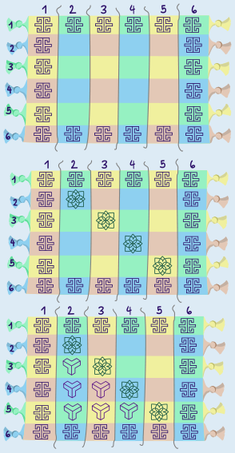

Antwort B ist richtig.

Die erste Frage der Anleitung wird genau für alle Felder am Rand des Teppiches mit „ja“ beantwortet. Denn jedes Randfeld liegt in Zeile 1 oder Zeile 6 oder in Spalte 1 oder Spalte 6. In diese Felder setzen die Angestellten also das Mäander-Symbol.

Für alle anderen Felder wird als nächstes die zweite Frage gestellt. Sie wird für alle Felder auf der Diagonalen mit „ja“ beantwortet; bei denen sind die Nummern der Zeilen und Spalten gleich. In diese Felder setzen die Angestellten also die grüne Blume.

Für die verbleibenden Felder wird die dritte Frage gestellt. Bei den Feldern links unterhalb der Diagonale ist die Nummer der Zeile größer als die Nummer der Spalte. Für sie wird die Frage also mit „ja“ beantwortet, und die Angestellten setzen dorthin das dreiarmige Symbol. Für die Felder rechts oberhalb der Diagonalen wird die Frage mit „nein“ beantwortet, und die Angestellten setzen dorthin die rosa Blume. Der Teppich sieht also am Ende so aus – wie in Antwort B:

## Das ist Informatik!

Die Anleitung, die Hale ihren Angestellten gegeben hat, kann man so zusammenfassen: Bei jedem Teppich-Feld werden nach und nach bis zu drei Bedingungen überprüft. Das Ergebnis der Überprüfung kann jeweils nur „ja“ oder „nein“ lauten. Die Entscheidung, welches Symbol in das Feld gesetzt wird, ergibt sich eindeutig aus den Ergebnissen der Überprüfungen. Damit würde jede Person, die diese Anleitung verwendet, genau das gleiche Teppichmuster herstellen. Im Prinzip könnte auch eine Maschine das Teppichmuster produzieren, sofern sie die Anleitung lesen und verstehen und Symbole in die Felder des Teppichs setzen kann.

In der Informatik nennt man eine solche eindeutige Anleitung einen Algorithmus. Wenn ein Algorithmus in einer Programmiersprache beschrieben ist und diese Beschreibung von einem Computer ausgeführt werden kann, spricht man von einem Computerprogramm. In praktisch allen Programmiersprachen gibt es Anweisungen, mit denen sich Bedingungen überprüfen lassen, wobei das Ergebnis der Überprüfung nur „ja“ oder „nein“ lauten kann. In der Informatik spricht man von bedingten Anweisungen und nennt solche Ja-Nein-Bedingungen boolesche Ausdrücke. Hales Teppichmuster-Algorithmus könnte also relativ leicht in einer Programmiersprache beschrieben werden.
