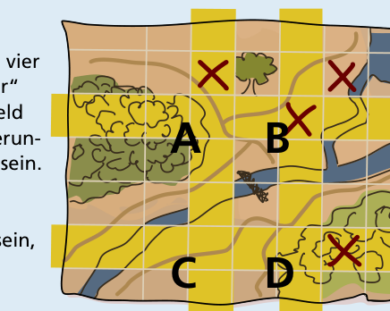
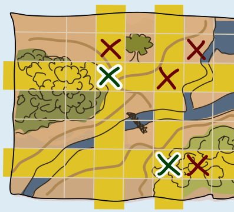

Die beiden Verstecke liegen in den Feldern, die in den Bildern unten mit A und D bezeichnet sind (A in der dritten Zeile von oben, D in der sechsten Zeile von oben).

Um die Felder zu finden, in denen die Verstecke liegen, schauen wir uns die Karte genau an. Die Markierungen der Verstecke wurden ja entfernt. Wir wissen, dass vorher in allen Zeilen und Spalten eine gerade Anzahl Markierungen vorhanden war (oder gar keine). Wir stellen fest, dass es nun zwei Zeilen und zwei Spalten mit Markierungen gibt, in denen die Anzahl der Markierungen nicht gerade ist:

Diese Zeilen und Spalten überschneiden sich und haben vier gemeinsame Felder (A, B, C und D). Diese „Schnittfelder“ sind besonders interessant. Nur wenn in einem Schnittfeld eine Markierung hinzukommt, wird die Zahl der Markierungen in Zeile und Spalte des Feldes anschließend gerade sein. Daher muss Bilbos Futter in den Schnittfeldern liegen.

Das Schnittfeld B ist markiert. Dort kann kein Versteck sein, da Bilbo die Markierungen der Verstecke entfernt hat.

Das Schnittfeld A muss vorher markiert gewesen sein; nur so konnte die Zeile von A eine gerade Anzahl von Markierungen haben. In A liegt also ein Versteck.

In Schnittfeld C kann kein Versteck sein: Sonst hätte die Spalte von A und C vorher drei Markierungen enthalten, also eine ungerade Zahl.

Das zweite Versteck muss also in Schnittfeld D liegen.

So sah also die Karte aus, bevor Bilbo die Markierungen der Verstecke entfernt hat, mit einer geraden Anzahl von Markierungen in jeder Zeile und Spalte:

## Das ist Informatik!

Bilbo verwendet in dieser Biberaufgabe eine Technik, die in der Informatik gut bekannt ist, nämlich Paritätsbits. Diese Technik ist dem Gebiet der fehlererkennenden bzw. -korrigierenden Codes zuzuordnen. In diesem Gebiet befasst sich die Informatik mit dem Problem, dass beim Speichern oder Übertragen von Daten Fehler auftreten können. Sind die Daten Folgen von Bits (0 oder 1), kann z. B. ein Bit „gedreht“ werden: dann wird aus einer 0 eine 1 oder umgekehrt. Um solche Fehler erkennen und evtl. sogar korrigieren zu können, kann man den Daten zusätzliche Bits hinzufügen. Diese Bits nennt man Paritätsbits, wenn ihr Wert so gesetzt wird, dass die Anzahl der 1en in der gesamten Bitfolge (Datenbits plus Paritätsbits) eine bestimmte Parität hat, also entweder „gerade“ oder „ungerade“ wird.

Ein Beispiel: Wenn wir, wie Bilbo, ein Paritätsbit hinzufügen und mit der Parität „gerade“ arbeiten, würden wir der Bitfolge 0110101 eine 0 hinzufügen, damit die Anzahl der 1en gerade bleibt. Wird bei der Übertragung der Ergebnisfolge 01101010 zum Beispiel das zweite Bit gedreht, erhält der Empfänger die Folge 00101010. Deren Parität ist „ungerade“, so dass der Empfänger den Übertragungsfehler erkennen kann. Korrigieren kann er ihn leider nicht, da er nicht erkennen kann, welches Bit gedreht wurde. Sollten bei der Übertragung gleich zwei Bits gedreht worden sein, kann der Empfänger auch das nicht erkennen, denn dann ist die Parität der empfangenen Bitfolge weiterhin „gerade“.
