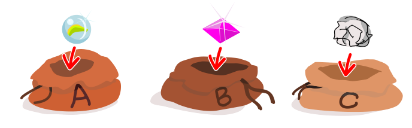
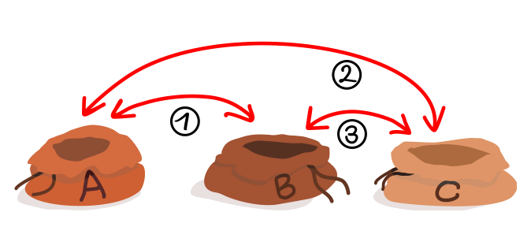

Lila legt eine Murmel in Beutel A, einen Edelstein in Beutel B und ein Stück Papier in Beutel C.

Dann vertauscht sie die Inhalte: zuerst die von Beutel A und Beutel B, danach die von A und C, und zuletzt die von B und C.

**Wo sind die drei Dinge dann?** Ordne jedem Ding den Beutel zu, in dem es am Ende liegt.
