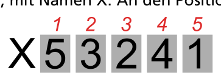
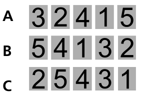

Hier siehst du eine Folge von Zahlen, mit Namen X. An den Positionen 1 bis 5 in der Folge X stehen diese Zahlen: 5, 3, 2, 4, 1

Die Zahl an einer bestimmten Position beschreiben wir, indem wir Namen und Position einklammern. Ein Beispiel: Die Zahl an Position 2 von Folge X beschreiben wir so: (X 2). Aktuell ist (X 2) = 3.

Eine so beschriebene Zahl in der Folge kann selbst auch eine Position sein. Zum Beispiel ist (X (X 2)) = (X 3) = 2.

Hier sind drei andere Folgen: A, B und C.

**Welche Zahl beschreiben wir so: (A (B (C 3))) ?**
