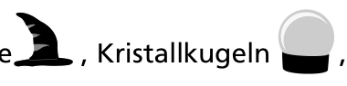
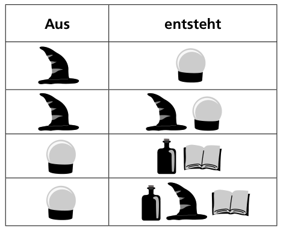

Im Zauberland gibt es vier verschiedene magische Objekte: Zauberhüte, Kristallkugeln, Zauberbücher und Zaubertränke.

Zauberhüte und Kristallkugeln können jeweils auf zwei verschiedene Weisen verwandelt werden. Die Tabelle zeigt, was dabei aus den Objekten entsteht – genau an der Stelle, wo sie vorher waren, und genau in der gezeigten Anordnung:

Verwandlungen können beliebig oft und in beliebiger Reihenfolge passieren. So kann aus einem einzigen magischen Objekt eine lange Anordnung von Objekten entstehen.

**Welche Anordnung kann aus einem einzigen Zauberhut NICHT entstehen?**
