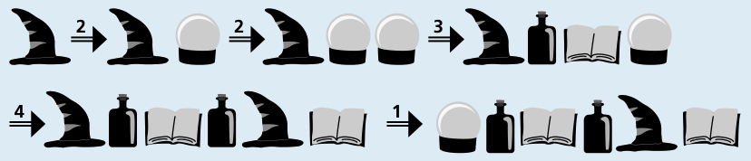

Antwort B ist richtig.

Zunächst nummerieren wir die vier Verwandlungen mit 1 bis 4, in der Tabelle von oben nach unten. Aus einem einzigen Zauberhut können die Anordnungen der Antworten A, C und D entstehen:

Antwort A (Verwandlungen 1, 4, 2, 3):

Antwort C (Verwandlungen 2, 2, 3, 4, 1):

Antwort D (Verwandlungen 2, 1, 3, 3):

Die Anordnung in Antwort B enthält unterschiedlich viele Zauberbücher (2) und Zaubertränke (3). Aber immer, wenn bei einer Verwandlung ein Zaubertrank entsteht (nämlich bei den Verwandlungen 3 und 4), entsteht auch ein Zauberbuch. In jeder Anordnung, die im Zauberland durch Verwandlungen entsteht, muss es also genau so viele Zauberbücher wie Zaubertränke geben. Die Anordnung in Antwort B kann also nicht entstehen, weder aus einem Zauberhut noch aus einer Kristallkugel.

## Das ist Informatik!

Wenn die Kristallkugeln und Zauberhüte aus dieser Biberaufgabe immer wieder verwandelt werden, entstehen immer wieder andere Anordnungen. Weil bei den Verwandlungen auch immer wieder neue Kristallkugeln und Zauberhüte entstehen, können unendlich viele Anordnungen entstehen. Es ist also nicht möglich, alle Anordnungen, die mit Hilfe der Verwandlungen entstehen können, aufzuschreiben. Aber das ist auch nicht nötig, denn die Menge der Anordnungen ist durch die Verwandlungen selbst genau festgelegt.

Noch bevor es Computer gab, ist die Idee entstanden, unendliche Mengen von Anordnungen mit Hilfe einer vergleichsweise kleinen und jedenfalls endlichen Menge von Verwandlungen zu beschreiben. In der Informatik heißen die Verwandlungen „Ersetzungsregeln“, Regelmengen heißen „Grammatiken“, und die Mengen, die sie definieren, werden konsequenterweise als „Sprache“ bezeichnet. Eine zentrale Rolle bei diesen „formalen Sprachen“ der Informatik spielt das Entscheidungsproblem: Gehört eine Anordnung von Objekten zur Sprache (also: kann es durch Anwendung der Regeln entstehen) oder nicht?

Beim Beantworten dieser Biberaufgabe musstest du dieses Problem für vier Anordnungen lösen. Zum Glück fällt die Zauberland-Grammatik in die Klasse der „kontextfreien Grammatiken“: Kristallkugeln und Zauberhüte können sich verwandeln, ohne zu beachten, welche Dinge sich um sie herum, also in ihrem Kontext, befinden. Für kontextfreie Grammatiken ist das Entscheidungsproblem generell gut lösbar, weshalb sie in der Informatik sehr beliebt sind, zum Beispiel um Programmiersprachen zu beschreiben.
