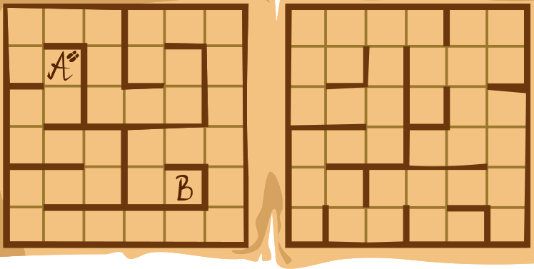

Die Zauberschule hat zwei Stockwerke. Die Stockwerke liegen genau übereinander. Beide sind in Felder eingeteilt, und es gibt Wände zwischen einigen Feldern:

Zauberschüler Ron braucht 1 Sekunde, um auf dem gleichen Stockwerk von einem Feld zum nächsten zu gehen. Leider hat Ron vergessen, wie er durch Wände gehen kann. Er kann aber von einem Stockwerk zum entsprechenden Feld des anderen Stockwerks gelangen; dazu braucht er 5 Sekunden.

Ron möchte von Feld A zu Feld B gelangen, und zwar so schnell wie möglich.

**Wie viele Sekunden braucht Ron dazu mindestens?**
