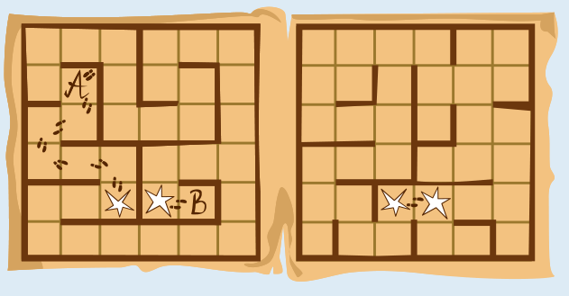
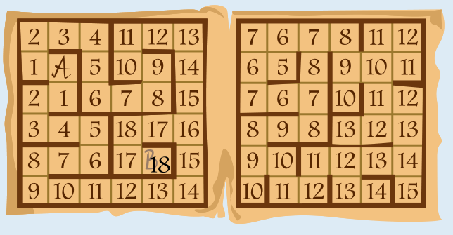

Antwort C (18 Sekunden) ist richtig.

So kann Ron in 18 Sekunden von A nach B gelangen:

Aber ist das der schnellste Weg? Die „kürzesten Zeiten“, die Ron benötigt, um von Feld A aus zu irgendeinem anderen Feld zu gelangen, kann man nach und nach so berechnen:

Für Feld A beträgt die kürzeste Zeit offensichtlich 0 Sekunden. Dann geht es schrittweise so weiter: Von allen Feldern, für die bereits eine kürzeste Zeit eingetragen ist, wählt man das mit dem geringsten Wert. (Ganz am Anfang wählt man also Feld A.) Von diesem gewählten Feld aus betrachtet man alle möglichen nächsten Felder und überlegt, wie man vom gewählten Feld am schnellsten dort hin kommt; die berechneten Zeiten trägt man bei den nächsten Feldern ein. Dabei kann es passieren, dass eine vorher eingetragene Zeit verbessert wird. Das gewählte Feld darf danach nicht mehr betrachtet werden; es kann also in den nächsten Schritten nicht mehr gewählt werden.

Hier sind die kürzesten Zeiten, die mit dieser Methode berechnet werden, ausgehend von Feld A:

Ron braucht also wirklich mindestens 18 Sekunden, um von Feld A zu Feld B zu gelangen. 6 Sekunden (Antwort A) wäre die Dauer des kürzesten Weges, wenn es keine Wände zwischen den Feldern gäbe. Wenn Ron dann trotzdem einmal zwischen den Stockwerken hin und her wechselte, würden 16 Sekunden (Antwort B) daraus. Gäbe es nur das Stockwerk mit den Feldern A und B, wären 20 Sekunden (Antwort D) die kürzeste Zeit für den Weg von A nach B.

## Das ist Informatik!

Schnellste oder kürzeste Wege müssen recht häufig berechnet werden; ein offensichtliches Beispiel ist die Routenplanung in modernen Karten-Apps. Das Problem wird deutlich vereinfacht, wenn die Wege aus einzelnen Schritten zwischen benachbarten Punkten bestehen und für alle diese Schritte bekannt ist, wie viel sie „kosten“: Zeit, Geld, Energieverbrauch – was auch immer die für das aktuelle Problem wichtige Größe ist. In diesem Fall lassen sich Punkte, Schritte und die Kosten der Schritte zu einem Graph abstrahieren, in dem Schritte zu Wegen zusammengesetzt werden können. Für Graphen sind in der Informatik viele Algorithmen bekannt, mit denen kürzeste Wege effizient berechnet werden können. Einer davon wurde vom Informatiker Edsger Dijkstra (1930–2002) erfunden; dieser Dijkstra-Algorithmus kam oben bei der Erklärung der richtigen Antwort zum Einsatz.

Auch beim Entwurf von Schaltkreisen für Computer spielen kürzeste Wege eine wichtige Rolle. Dabei müssen Schaltpunkte mit möglichst geringen Kosten miteinander verdrahtet werden. Moderne Schaltkreise bestehen aus mehreren Ebenen, und eine Verdrahtung zwischen zwei Ebenen ist teurer als eine (ansonsten vergleichbare) Verdrahtung auf der gleichen Ebene – ähnlich zum Wechsel zwischen den Stockwerken in dieser Biberaufgabe, der teurer ist als ein Schritt auf dem gleichen Stockwerk.
