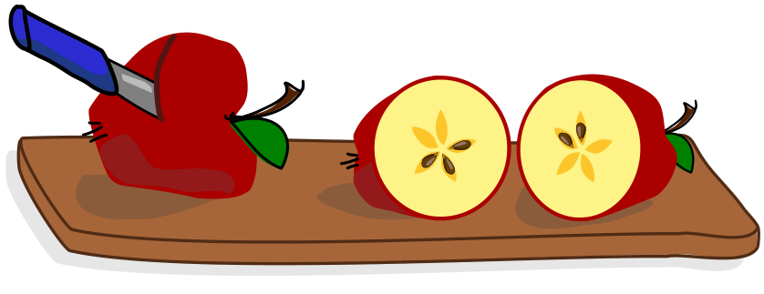

Äpfel kann man in eine obere und untere Hälfte teilen. Einige Apfelkerne bleiben in der oberen Hälfte, die anderen in der unteren Hälfte. An den Löchern und Kernen sieht man, dass die Hälften zusammen passen:

Gala halbiert vier Äpfel. Sie legt die oberen Hälften links und die unteren Hälften rechts untereinander.

**Welche Apfelhälften passen zusammen? Ordne die Apfelhälften einander zu.**
