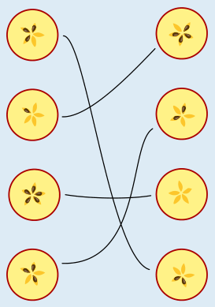

Jeder Apfel hat 5 Apfelkerne. Zwei zueinander passende Apfelhälften müssen also insgesamt 5 Kerne haben. Diese Hälften können damit einfach zugeordnet werden.

Die übrigen vier Hälften sind nicht so einfach zuzuordnen. Die beiden oberen Hälften haben jeweils 3 Kerne, die beiden unteren Hälften haben jeweils 2 Kerne. Deshalb schauen wir uns die Muster der Apfelkerne genauer an. Denn wenn zwei Hälften zusammen passen, passen auch die Muster zusammen. Um das zu sehen, kann es aber nötig sein, die Hälften zu drehen.

Dann lassen sich die Hälften so zuordnen wie im Bild: Oben hat die obere Hälfte drei Kerne direkt hintereinander und danach zwei Löcher (K-K-K-L-L), die untere Hälfte hat drei Löcher direkt hintereinander und danach zwei Kerne (L-L-L-K-K): die Hälften passen zusammen. Auch unten passen die beiden Hälften zusammen: Das Muster der oberen Hälfte lautet (wenn man oben beginnt und im Uhrzeigersinn weitermacht) K-L-K-L-K, das Muster der unteren Hälfte (wenn man unten beginnt) L-K-L-K-L.

## Das ist Informatik!

Bei der Erklärung der richtigen Antwort haben wir gesehen: Wenn zwei Hälften zusammen passen, passen nicht nur die Anzahlen der Kerne zusammen, sondern auch die Reihenfolgen der Kerne und Löcher (also der leeren Kernfächer). Für die richtige Zuordnung der Hälften muss man also auch diese Reihenfolgen betrachten. Es genügt nicht zu wissen, wie viele Kerne in jeder Hälfte sind.

Bei Problemen, die mit Hilfe von Computerprogrammen gelöst werden sollen, stellen sich ähnliche Fragen. Informatikerinnen und Informatiker müssen sich Gedanken machen, wie die Informationen, die das Programm berücksichtigen soll, als Daten beschrieben werden. Dabei wird oft versucht, es so einfach wie möglich zu machen. Einfache Programme sind nämlich weniger anfällig für Fehler. Beim Apfelhälften-Problem in dieser Biberaufgabe schien es zunächst ausreichend zu sein, die Hälften allein durch die Anzahl der Kerne zu beschreiben. Doch dann wurde klar, dass das nicht in allen Fällen genügt. Zur Beschreibung der Apfelhälften in einem Computerprogramm muss es also möglich sein, eine Reihenfolge zu beschreiben. Das geht zum Beispiel mit Hilfe der Datenstruktur Liste, die in den meisten Programmiersprachen zur Verfügung steht.
