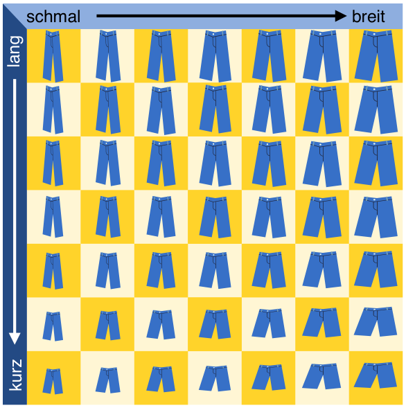

Christian braucht neue Hosen. Im Geschäft gibt es seine Lieblings-Hose in sieben Längen und sieben Breiten. Hosen in allen 49 Größen sind im Regal, nach Länge und Breite sortiert.

Weil Christian seine richtige Größe nicht weiß, muss er sie durch Anprobieren herausfinden. Bei jeder Anprobe merkt Christian, ob die Hose passt oder ob er eine kürzere, längere, schmalere oder breitere Hose braucht. Damit eine Hose passt, müssen Länge und Breite stimmen.

Der Verkäufer stöhnt: Bei 49 Größen die richtige zu finden – das kann dauern.

Doch Christian ist eine Methode eingefallen, die richtige Größe in jedem Fall nach möglichst wenigen Anproben zu wissen.

**Wie viele Anproben braucht er mit dieser Methode höchstens, bis er die richtige Größe weiß?**
---
