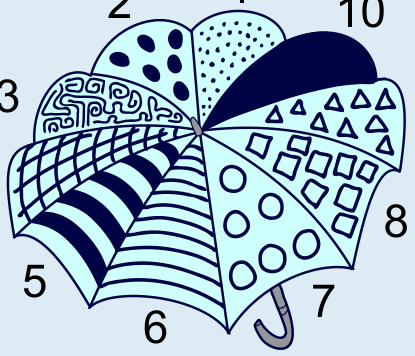

**Antwort C** ist richtig.

Jedes Muster auf Aylas Regenschirm kommt genau einmal vor.

Um das korrekte Bild zu finden, vergleichen wir nacheinander jedes der Bilder mit Aylas Regenschirm:

- Wir wählen das Muster, welches am weitesten links ist, und suchen dessen Position auf Aylas Regenschirm.
- Wir prüfen, ob die angrenzenden Muster dieselben sind wie die auf Aylas Regenschirm.

Jedes Antwortbild zeigt eine Folge von fünf Mustern. Ob eine dieser Folgen mit der vollständigen Reihenfolge aller zehn Muster von Aylas Regenschirm übereinstimmt, können wir nicht wissen. Bild C zeigt aber als einziges eine Folge, die vollständig mit einer Folge von fünf Mustern auf Aylas Regenschirm übereinstimmt. Aus diesem Grund kann nur Bild C Aylas Regenschirm zeigen. Alle anderen Bilder zeigen Musterfolgen, die nicht oder nur teilweise mit Aylas Regenschirm übereinstimmen. Diese Bilder können also nicht Aylas Regenschirm zeigen.

## Das ist Informatik!

In den Antwortmöglichkeiten ist jeweils nur ein Teil der Musterfolge abgebildet. Obwohl sie nur eine Teilinformation enthalten, können wir feststellen, welches der vier Bilder Aylas Regenschirm zeigt: Ein Bild zeigt nur dann Aylas Regenschirm, wenn die Musterfolge vollständig in der Musterfolge von Aylas Regenschirm enthalten ist.

Das gleiche Prinzip wie bei der „Regenschirm-Mustersuche“ wird bei der Suche in einem Textdokument angewendet. Der Computer sucht mit gegebenen Teilinformationen (Suchwort) nach passenden Zeichenketten im Dokument. Eine Zeichenkette ist eine Folge von Zeichen (z. B. Buchstaben, Ziffern, Sonderzeichen). Dabei gilt bei der Suche:

- Je länger das Suchwort, desto weniger mögliche Übereinstimmungen gibt es und desto größer ist die Chance, die gesuchte Stelle im Dokument zu finden.
- Je kürzer das Suchwort, desto mehr mögliche Übereinstimmungen ergibt die Suche und desto ungenauer ist die Suche.

Um das Durchsuchen zu verbessern, wurden verschiedene Suchverfahren (oder Suchalgorithmen) entwickelt. Sie sollen möglichst schnell eine genaue Suche durchführen und ein passendes Resultat liefern. Diese Suchalgorithmen werden ständig weiterentwickelt und können riesige Datenmengen in sehr kurzer Zeit durchsuchen (z. B. Internetsuchmaschinen verwenden solche Suchalgorithmen).
