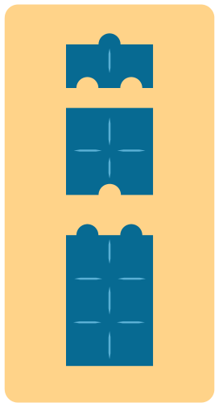

Die Biber-Bausteine unterscheiden sich in vier Eigenschaften:

1. Breite: schmal, mittel, breit
2. Höhe: klein, mittel, groß
3. Anzahl der Noppen oben: null, eins, zwei
4. Anzahl der Nuten unten: null, eins, zwei

Otto teilt die Bausteine in Dreier-Gruppen ein. Er macht das so, dass für jede Gruppe gilt: Die drei Steine haben für jede der vier Eigenschaften ...

- ... entweder alle den gleichen Wert ...
- ... oder drei unterschiedliche Werte.

Hier ist eine von Ottos Gruppen:

Denn diese drei Steine haben alle

- die gleiche Breite,
- unterschiedliche Höhen,
- unterschiedlich viele Noppen und
- unterschiedlich viele Nuten.

**Teile diese Bausteine in Dreier-Gruppen ein, so wie Otto es machen würde.**

Ziehe dazu jeden Baustein in eine der Gruppen A, B oder C. In jeder Gruppe sind genau drei Steine.
