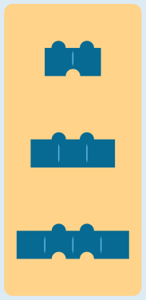
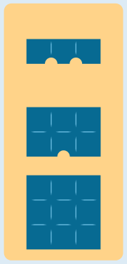
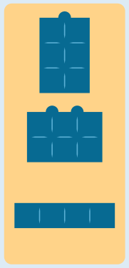

---
answers:
  - { ga: [s11, s13, s3], gb: [s10, s12, s8], gc: [s14, s7, s9] }
  - { ga: [s11, s13, s3], gc: [s10, s12, s8], gb: [s14, s7, s9] }
  - { gb: [s11, s13, s3], ga: [s10, s12, s8], gc: [s14, s7, s9] }
  - { gb: [s11, s13, s3], gc: [s10, s12, s8], ga: [s14, s7, s9] }
  - { gc: [s11, s13, s3], ga: [s10, s12, s8], gb: [s14, s7, s9] }
  - { gc: [s11, s13, s3], gb: [s10, s12, s8], ga: [s14, s7, s9] }
---
So sind die Steine in Gruppen eingeteilt, wie Otto es machen würde. Die Gruppen heißen hier 1 bis 3; welche der Gruppen A, B und C man dafür wählt, ist egal.

  

Die Tabelle zeigt für die drei Gruppen, bei welchen Eigenschaften die Werte alle unterschiedlich bzw. alle gleich sind.

| Eigenschaft | Gruppe 1 | Gruppe 2 | Gruppe 3 |
|---|---|---|---|
| Breite | unterschiedlich | gleich | unterschiedlich |
| Höhe | gleich | unterschiedlich | unterschiedlich |
| Noppen | gleich | gleich | unterschiedlich |
| Nuten | unterschiedlich | unterschiedlich | gleich |

Aber ist das die einzige Möglichkeit, die Steine so einzuteilen, wie Otto es machen würde? Man kann überlegen: Wenn für eine Eigenschaft die Werte in allen Gruppen unterschiedlich sein sollen, müssen die verschiedenen Werte in allen Steinen genau so oft vorkommen, wie es Gruppen gibt. Ist das nicht der Fall, muss es mindestens eine Gruppe geben, in der die Werte für diese Eigenschaft alle gleich sind. Ein genauer Blick auf alle Steine zeigt, dass bei der Breite die Werte schmal und breit jeweils nur zweimal vorkommen. Es muss also eine Gruppe geben, in der alle Steine die Breite mittel haben. Von den fünf Steinen mit mittlerer Breite gibt es keinen mit nur einer Noppe; deshalb kann keine Gruppe mit unterschiedlich vielen Noppen gebildet werden. Es gibt aber drei Steine mit null Noppen – und sie haben alle unterschiedliche Höhen und unterschiedlich viele Nuten. Damit ist Gruppe 2 die einzig mögliche Gruppe von Steinen mit mittlerer Breite. In den anderen beiden Gruppen müssen die Breiten alle unterschiedlich sein. In den verbleibenden sechs Steinen kommen bei der Höhe die Werte groß und mittel nur noch einmal vor. Es muss also eine Gruppe geben, in der alle Steine die Höhe klein haben. Gruppe 1 ist die einzig mögliche Dreier-Gruppe von Steinen mit kleiner Höhe, die Ottos Vorstellungen entspricht. Damit bleiben die drei Steine in Gruppe 3 übrig. Sie bilden ebenfalls eine Dreier-Gruppe, wie Otto sie auch bilden würde.

## Das ist Informatik!

In dieser Biberaufgabe werden die Biber-Bausteine mit Hilfe von vier Eigenschaften (oder Attributen) beschrieben. Um die Bausteine wie Otto in Dreier-Gruppen aufteilen zu können, muss man für jeden Stein die Werte der Eigenschaften kennen. Dazu genügt Menschen ein Blick auf jeden Baustein. Ein Computerprogramm, das die Dreier-Gruppen zusammenstellen soll, kann in der Regel nicht sehen und braucht eine Beschreibung in einer Datenstruktur. Zum Beispiel kann man die Steine in einer Datenbank als Zeilen einer Tabelle beschreiben. Die Spalten der Tabelle entsprechen den Eigenschaften, und in jeder Zeile (auch Datensatz genannt) stehen die Werte eines Bausteins in den passenden Spalten:

| Stein-Nr | Breite | Höhe | Noppen | Nuten |
|---|---|---|---|---|
| 1 | schmal | hoch | 1 | 0 |
| 2 | mittel | mittel | 2 | 0 |
| … | … | … | … | … |

Der Entwurf von Datenbank-Tabellen gehört zu den üblichen Tätigkeiten für Informatikerinnen und Informatiker. Sie müssen dabei gründlich vorgehen und überlegen, welche Eigenschaften von Objekten für die Verarbeitung durch ein Computerprogramm wichtig sind. Nachträgliche Änderungen sind nicht so einfach, insbesondere wenn schon Daten vieler Objekte gespeichert sind.
