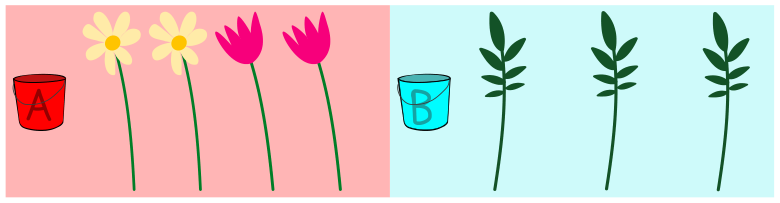

Florian verkauft Blumensträuße. Jeden Blumenstrauß bindet Florian nach dieser Anleitung:

1. Nimm die erste Blume aus Eimer A.
2. Wenn die erste Blume eine Margarite ist, nimm noch eine Margarite.
3. Nun nimm solange einen Zweig aus Eimer B, bis der Blumenstrauß 4 Teile hat. Fertig!

**Hilf Florian: Folge der Anleitung und wähle Blumen und Zweige für einen Strauß aus.**

Ziehe dazu die Blumen und Zweige in den Blumenstrauß.
