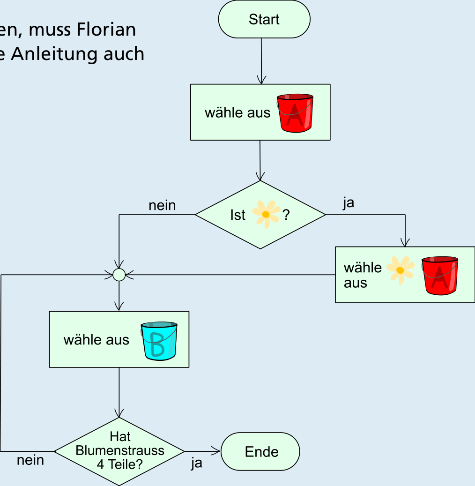

---
answers:
  - [tulpe, zweig, zweig, zweig]
  - [margarite, margarite, zweig, zweig]
---
Es gibt zwei richtige Lösungen:

Um die Blumensträuße korrekt zu binden, muss Florian die Anleitung befolgen. Wir können die Anleitung auch mit einem Diagramm beschreiben:

Nachdem Florian die erste Blume aus Eimer A gewählt hat, folgt eine Entscheidung, die abhängig von der ersten Blume ist. Entweder nimmt er noch eine Margarite oder folgt dem „nein“-Pfeil und nimmt einen Zweig.

Dann überprüft er, ob er schon vier Teile hat. Wenn nicht, folgt er dem „nein“-Pfeil und muss einen weiteren Zweig nehmen und dann die Anzahl der Teile wieder überprüfen.

Wenn er also zuerst eine Margarite nimmt, wird er noch eine Margarite nehmen und dann zweimal einen Zweig nehmen. Wenn er aber zuerst eine Tulpe nimmt, wird er danach direkt zu „wähle aus Eimer B“ gehen und solange einen Zweig nehmen, bis er 4 Teile hat – also insgesamt 3 Zweige nehmen.

## Das ist Informatik!

Die Anleitung fürs Binden des Blumenstraußes ist klar und könnte von einer Maschine ausgeführt werden. In der Informatik nennt man dies einen Algorithmus. Die Anleitung benutzt einige Anweisungen, die auch in Computerprogrammen üblich sind:

- Die erste Anweisung ist eine zufällige Auswahl aus einer Menge von Objekten.
- Die zweite Anweisung nennt man eine bedingte Anweisung (engl. if-statement) oder eine Verzweigung: Denn du musst aus zwei oder mehr Möglichkeiten auswählen.
- Die dritte Anweisung sieht relativ einfach aus, muss aber in einem Computerprogramm gut strukturiert werden. Der innere Teil der Anweisung (selbst wieder eine Anweisung: „Nimm einen Zweig aus Eimer B“) muss mehrmals ausgeführt werden, bis der Blumenstrauß aus 4 Teilen besteht. Die Ausführung der inneren Anweisung wird also solange wiederholt, bis die Bedingung „Der Blumenstrauß besteht aus 4 Teilen.“ erfüllt ist. Eine solche Wiederholungs-Anweisung nennt man auch Schleife.

Ein Algorithmus kann unterschiedlich dargestellt werden. In dieser Biberaufgabe ist Florians „Blumenstrauß-Algorithmus“ als Anleitung in natürlicher Sprache formuliert. In der Lösungserklärung ist er als Programmablaufplan dargestellt.

Floristik ist eine Handwerkskunst. Es existieren Traditionen und Regeln, wie ein Blumenstrauß oder ein Kranz gebunden wird. Dies ist ein Beispiel dafür, dass Anleitungen oder Algorithmen in vielen Lebensbereichen vorkommen, nicht nur in der Informatik.
