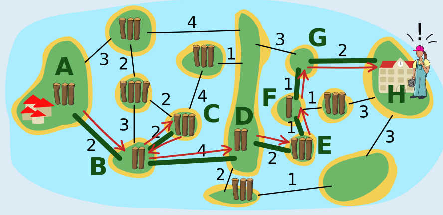

Die grünen Linien zeigen, wo Bianca Brücken gebaut hat. Die roten Pfeile zeigen, wie Bianca über die Brücken gegangen ist:

- Auf der Insel A nimmt sie die drei Baumstämme und benutzt zwei davon für die erste Brücke. Mit dem verbleibenden Baumstamm geht sie über die Brücke und hat auf der Insel B 3 − 2 + 2 = 3 Baumstämme. Das sind nicht genug, um eine Brücke zur Insel D zu bauen.
- Deshalb baut sie mit 2 Stämmen eine Brücke zur Insel C. Sie geht über die Brücke, nimmt die 3 Stämme von der Insel C und geht zurück. Nun hat sie 3 − 2 + 3 = 4 Stämme.
- Damit baut sie eine Brücke zur Insel D, geht über die Brücke und hat dann die 2 Stämme von Insel D.
- Damit baut sie eine Brücke zur Insel E und kann dort 3 Stämme nehmen. Sie baut weitere Brücken zu den Inseln F und G. Auf der Insel E hat sie also 3 Stämme, auf der Insel F 3 − 1 + 1 = 3 Stämme und auf der Insel G noch 2 Stämme.
- Die reichen genau, um eine Brücke zur Insel H mit der Schule zu bauen.

Insgesamt konnte Bianca also Brücken für einen Weg von Insel A zu Insel H bauen und hat dafür 14 Baumstämme benutzt. Aber geht es auch mit weniger Stämmen? Dazu müssen alle möglichen Wege untersucht werden. Weil die alle über die lange Insel D führen, lässt sich das Problem in zwei Teile zerlegen: Von Insel A zu Insel D, und von Insel D zu Insel H:

- Für die Brücken von Insel A bis Insel D hat Bianca 8 Stämme benutzt und kam ohne Stamm auf Insel D an. Wir notieren ihren Weg so: 2-[2,2]-4 (von der Insel A über die Linie mit der 2 zur Insel B, dann zwischen B und C hin und zurück über die 2, dann über die 4 zu Insel D). Ein Weg mit weniger Stämmen wäre 3-4, kann aber nur mit Umweg gebaut werden (3-[2,2]-4), verbraucht also 9 Stämme, wobei Bianca auf Insel D mit einem Stamm im Vorrat ankommt. Alle anderen Wege von Insel A bis D verbrauchen 9 Stämme oder mehr.
- Für die Brücken von Insel D bis H hat Bianca 6 Stämme benutzt. Den direkten Weg 3-2 kann sie nicht bauen, auch nicht mit einem Stamm im Vorrat. Alle anderen Wege von Insel D zu Insel H verbrauchen 6 Stämme oder mehr.

Es ist also nicht möglich, mit weniger als 14 Stämmen Brücken zu bauen, über die die Kinder von der Dorf-Insel A zur Schul-Insel H gehen können. Mit den von ihr gebauten Brücken hat Bianca also ihr Ziel erreicht.

## Das ist Informatik!

Die Insel-Karte mit den durch Linien angezeigten „Brücken-Bauplätzen“ kann als Graph modelliert werden: Das ist eine mathematische Struktur, die Objekte (auch Knoten genannt) paarweise miteinander in Relation setzt (die Paare nennt man auch Kanten). In einem Graphen kann man die Inseln als Knoten und die Linien als Kanten modellieren. Dabei haben die Kanten Gewichte, nämlich die Anzahl der für den Brückenbau entlang einer Linie benutzten Baumstämme, aber auch die Knoten (die Anzahl der Stämme auf einer Insel) – das ist eher ungewöhnlich. Für Graphen, bei denen nur die Kanten gewichtet sind, kennt die Informatik mehrere effiziente Algorithmen, die einen kürzesten Weg (über Kanten mit minimaler Summe der Gewichte) zwischen zwei Knoten berechnen können.

Das Problem, das Bianca in dieser Biberaufgabe optimal lösen möchte, ist komplizierter: Sie möchte zwar auch einen kürzesten Weg gehen, hat aber eine Randbedingung: Die Summe der Knotengewichte auf ihrem bisherigen Weg (die Stämme, die sie nehmen konnte) abzüglich der Summe der Kantengewichte auf ihrem Weg (die Stämme, die sie für den Brückenbau benutzt hat) muss größer sein als das Gewicht der Kante, die sie als nächste gehen bzw. wo sie eine Brücke bauen möchte. Um den optimalen Weg zu finden, müssen hier eventuell alle Möglichkeiten ausprobiert werden. Die Zerlegung des Problems in zwei Teile hilft, die Anzahl der Möglichkeiten zu reduzieren. Und wegen der Randbedingung kann man viele Möglichkeiten ausschließen, bevor man sie komplett probiert hat. In der Informatik ist ein solches Vorgehen (Probieren und Ausschließen) als Backtracking bekannt (siehe auch die Biberaufgabe „Gemüsebeet“).
