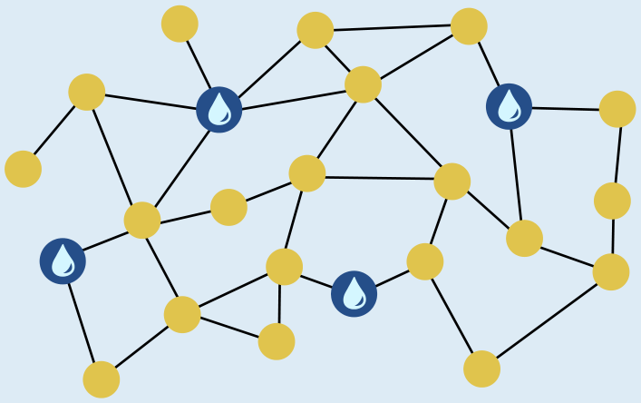
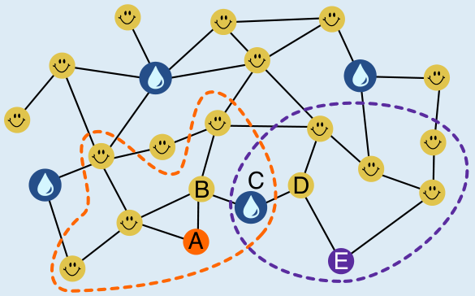

Wenn ein weiterer Brunnen unten in der Mitte aufgestellt wird, muss man von jeder Straßenecke aus höchstens zwei Straßenabschnitte gehen, um einen Brunnen zu erreichen. Dann ist die Bürgermeisterin zufrieden.

Wie können wir herausfinden, an welcher Straßenecke ein weiterer Brunnen aufgestellt werden soll?

Im Stadtplan markieren wir alle Straßenecken mit einem Smiley, die höchstens zwei Straßenabschnitte von einem der Brunnen entfernt sind, die bereits aufgestellt sind. In Bezug auf diese Ecken kann die Bürgermeisterin bereits zufrieden sein.

Für die fünf übrigen Straßenecken A, B, C, D und E stellen wir einen weiteren Brunnen bei C auf. Damit muss man auch von diesen Ecken höchstens zwei Straßenabschnitte zum nächsten Brunnen gehen.

Die Ecke C ist die einzige Stelle für einen neuen Brunnen, die das ermöglicht: Wenn wir für die Ecken A und E jeweils alle anderen Ecken betrachten, die über zwei Straßenabschnitte erreichbar sind, ist die Straßenecke C die einzige, die diese Bedingung für A und E erfüllt.

## Das ist Informatik!

Der Stadtplan kann als Graph modelliert werden. Das ist ein für die Informatik wichtiges Werkzeug, um Beziehungen zwischen Objekten zu modellieren und Fragen in Bezug auf diese Beziehungen zu beantworten. Hier kann man die Straßenecken als Objekte und damit Knoten des Graphen auffassen. Die Beziehung zwischen zwei Objekten wird im Graph durch Kanten modelliert, die man als Verbindungslinien darstellt. Hier bedeutet eine Kante zwischen zwei Straßenecken, dass sie durch einen Straßenabschnitt verbunden sind. Diese Beziehung kann man Nachbarschaft nennen. Kanten können aber auch andere Beziehungen modellieren, wie z. B. Freundschaft.

In dieser Biberaufgabe soll eine Teilmenge der Knoten gefunden werden (zum Aufstellen der Brunnen), so dass jeder Knoten außerhalb dieser Teilmenge über einen Weg mit einem „Brunnen-Knoten“ verbunden ist, der höchstens zwei Kanten lang ist. In der Fachsprache der Informatik würde dies als Suche nach einem „distance 2-dominating set“ bezeichnet. Im allgemeinen (für alle Weglängen k ≥ 1) gehört diese Suche nach einer möglichst kleinen solchen Teilmenge zu den schwierigsten Problemen der Informatik.

Solche „minimum distance k-dominating sets“ spielen in der letzten Zeit eine größere Rolle, insbesondere im Bereich des Social Computing (auf Deutsch auch Sozioinformatik): Zur automatischen Verarbeitung von Daten über soziale Netzwerke (etwa um die Verbreitung von Fake News zu erkennen) werden die Fan- oder Follower-Beziehungen zwischen den Nutzern als Graph modelliert. Diese Graphen können so groß sein, dass nur eine (möglichst kleine) repräsentative Auswahl von Nutzern betrachtet werden kann – zum Beispiel ein „minimum distance 3-dominating set“. Da die wirklich kleinste Auswahl nicht effizient berechnet werden kann, entwickelt die Informatik Verfahren, die in kurzer Zeit möglichst kleine, aber nicht garantiert kleinste Auswahlen berechnen.
