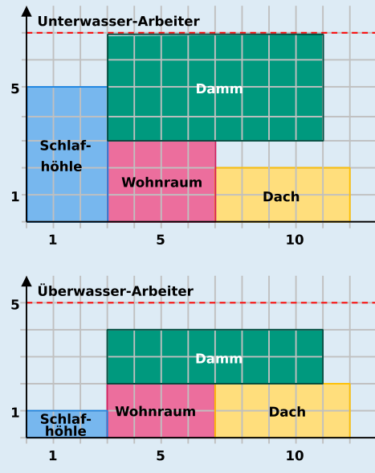

**12** ist die richtige Antwort.

Dies ist ein Plan, mit dem die Biberburg in 12 Tagen fertig wird:

Einen solchen Plan mit der kürzesten Bauzeit kann man in zwei Schritten bestimmen:

1. Zuerst muss die Schlafhöhle vor dem Dach eingeplant werden. Da die Schlafhöhle 5 Unterwasser-Arbeiter benötigt, der Damm 3 und der Wohnraum 4, kann die Schlafhöhle – bei der Beschränkung auf 7 Unterwasser-Arbeiter – auch nicht gleichzeitig mit Damm oder Wohnraum gebaut werden. Die Schlafhöhle muss also zuerst gebaut werden und alle drei anderen Teile danach.
2. Damm und Wohnraum können gleichzeitig nach der Schlafhöhle gebaut werden, oder eines der beiden Teile gleichzeitig mit dem Dach. Es ist aber nicht möglich, alle drei Teile gleichzeitig zu bauen, weil sie zusammen 3 + 4 + 2 = 9 Unterwasser-Arbeiter benötigen – mehr als zur Verfügung stehen. Die kürzeste Bauzeit kann erzielt werden, wenn die beiden Teile mit den kürzeren Bauzeiten (Dach und Wohnraum) hintereinander und der Damm gleichzeitig zu diesen gebaut werden.

## Das ist Informatik!

Einen optimalen, möglichst zügigen Ablauf eines Projekts zu planen, ist eine schwierige Aufgabe, bei der einige Bedingungen zu berücksichtigen sind. Zwischen Teilaufgaben eines Projekts bestehen oft zeitliche Abhängigkeiten; z. B. kann es Teilaufgaben geben, die erst nach Beendigung einer anderen Teilaufgabe begonnen werden können – wie hier bei Dach und Schlafhöhle. Außerdem braucht jede Teilaufgabe bestimmte Ressourcen wie Arbeitskraft, Zeit und Geräte. Bei der Erstellung von Projektplänen hilft es, wenn man den Plan gut darstellen kann. Die in dieser Biberaufgabe gezeigten Diagramme sind eine Art von Gantt-Diagrammen, die von Henry Gantt (1861–1919) zwischen 1910 und 1915 entwickelt wurden; ähnliche Darstellungen wurden unabhängig von Gantt zur gleichen Zeit auch in Deutschland verwendet. Sie zeigen die Nutzung von Ressourcen (in diesem Fall die beiden Arten von Arbeitskräften) im Zeitverlauf.

Den optimalen Plan für die Biberburg kann man sich im Kopf überlegen und dabei alle erlaubten Möglichkeiten ausprobieren. Bei größeren Projekten würde das zu lange dauern und zu unübersichtlich werden. Hier können Computerprogramme helfen, und deshalb ist die Erstellung von Zeitplänen (engl. Scheduling) ein wichtiges Thema der Informatik. Wie häufig bei schwierigen Problemen wurden Verfahren entwickelt, die statt eines garantiert optimalen Plans einen Plan mit etwas größerem, aber immer noch sehr gutem Zeitbedarf erstellen. Scheduling wird auch bei der Steuerung von Computern selbst angewandt, deren Prozesse um Ressourcen (Rechenleistung, Speicherzugriff, Zugriff auf externe Geräte wie Speichergeräte, Drucker oder Netzwerkschnittstellen) konkurrieren.
