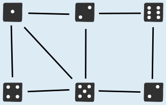
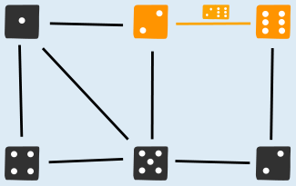
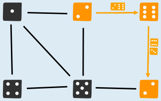

Drei der acht Steine können nicht an den Anfang oder das Ende der Reihe gelegt werden: die Steine 5 und 4, 5 und 3 sowie 6 und 3.

Um die Aufgabe zu lösen, untersuchen wir die Augenzahlen (die Punkte auf Dominosteinen nennt man auch Augen, wie bei einem Würfel) der 16 Felder der Dominosteine. Wir halten fest, wie häufig die einzelnen Augenzahlen vorkommen, und ob die Häufigkeit eine gerade oder eine ungerade Zahl ist:

| Augenzahl | Häufigkeit | |
|---|---|---|
| 1 | 3 | ungerade |
| 2 | 3 | ungerade |
| 3 | 2 | gerade |
| 4 | 2 | gerade |
| 5 | 4 | gerade |
| 6 | 2 | gerade |

Felder mit Augenzahlen, die mit gerader Häufigkeit vorkommen, müssen paarweise mitten in der Reihe liegen oder gleichzeitig an Anfang und Ende. Felder mit Augenzahlen, die mit ungerader Häufigkeit vorkommen, können aber nicht alle mitten in der Reihe liegen: Es kann nämlich nicht für jedes Feld mit dieser Augenzahl ein passendes angrenzendes Feld gefunden werden; das geht nur bei gerader Häufigkeit. Hier siehst du eine Reihe, in die ein Stein mit der dreimal vorkommenden Augenzahl 1 nicht mehr mitten hinein passt.

Da es in den acht Steinen dieser Biberaufgabe Felder mit ungerader Häufigkeit gibt, müssen Steine mit solchen Feldern außen liegen. Steine, die zwei Felder mit gerader Häufigkeit haben, können also nicht an den Anfang oder das Ende der Reihe gelegt werden. Das sind die drei oben markierten Steine.

## Das ist Informatik!

Es gibt mehrere Möglichkeiten, die acht Dominosteine dieser Biberaufgabe in eine korrekte Reihe zu legen. Um sich hier eine bessere Übersicht zu verschaffen, verwenden Informatiker sogenannte Graphen:

Im Graphen oben sind Quadrate (sogenannte Knoten) ersichtlich, die die sechs Augenzahlen der Dominosteine aufzeigen. Die acht Linien (sogenannte Kanten) stellen die acht Dominosteine dar; jede Linie verbindet zwei Felder. Der Dominostein 2-6 wird beispielsweise durch die folgende Kante dargestellt:

Um die Aufgabe zu lösen, müssen alle acht Dominosteine passend aneinander gereiht werden. Dabei ist nach dem Legen des ersten Dominosteins bereits klar, mit welcher Augenzahl der zweite Stein beginnen muss, denn angrenzende Felder zweier Steine sollen ja immer die gleiche Augenzahl haben. Im Graph erkennt man dies dadurch, dass Dominosteine genau dann nebeneinander gelegt werden dürfen, wenn deren Kanten sich bei demselben Knoten treffen. Die Steine 2-6 und 6-3 können beispielsweise aneinander gelegt werden, da sie beide die Augenzahl 6 enthalten:

Das Aneinanderreihen der Dominosteine lässt sich als Weg (eine Abfolge von Kanten) durch den Graphen verstehen. Dieser Weg soll sämtliche Kanten genau einmal besuchen, um sicherzustellen, dass die acht Dominosteine einerseits alle verwendet werden, andererseits aber auch nicht mehrmals zum Einsatz kommen. Ein Weg, der jede Kante genau einmal besucht, wird Eulerweg genannt. Der Name geht auf Leonhard Euler, einen Schweizer Mathematiker und den Erfinder der Graphentheorie, zurück. Euler konnte zeigen, dass in einem zusammenhängenden Graphen ein Eulerweg genau dann existiert, wenn maximal zwei Knoten eine ungerade Anzahl von diesem Knoten ausgehender Kanten haben.
