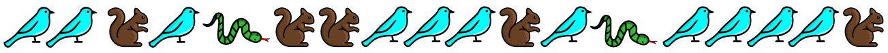

Jona hat einen besonderen Apfelbaum im Garten:

- Landet ein **Vogel** auf dem Baum, wachsen sofort zwei neue Äpfel.
- Klettert ein **Eichhörnchen** auf den Baum, fällt ein Apfel runter. Wenn kein Apfel am Baum hängt, passiert nichts.
- Besucht eine **Schlange** den Baum, verschwinden alle Äpfel sofort.

Heute Morgen hängen 25 Äpfel am Baum. Dann besuchen einige Tiere nacheinander den Baum, zuletzt ein Eichhörnchen. Jona hat ihre Reihenfolge genau aufgeschrieben:

**Wie viele Äpfel hängen danach am Baum?**
