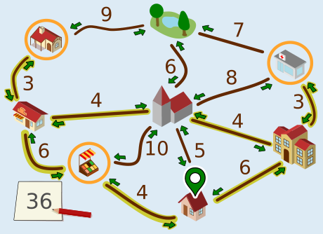
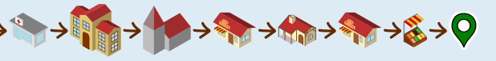
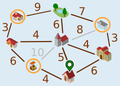
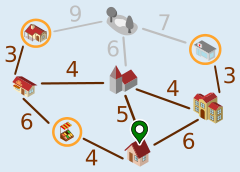
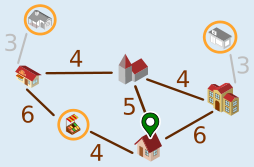
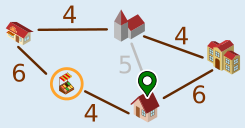
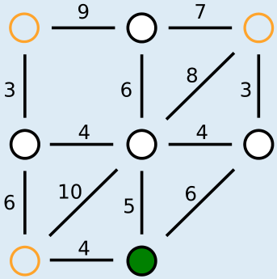

---
answers:
  - [zuhause, schule, apotheke, schule, rathaus, baeckerei, kiosk, baeckerei, markt, zuhause]
  - [zuhause, markt, baeckerei, kiosk, baeckerei, rathaus, schule, apotheke, schule, zuhause]
---
Emma kann so entlang der ausgewählten Strecken gehen (oder in die Gegenrichtung):

Für diesen Weg braucht sie 6 + 3 + 3 + 4 + 4 + 3 + 3 + 6 + 4 = 36 Minuten.

Nun wollen wir begründen, warum es keinen noch kürzeren Weg geben kann. Dazu benutzen wir eine vereinfachte Darstellung des Plans.

Die grau gezeichneten Strecken können wir ignorieren. Es gibt kürzere Wege zwischen den durch die Strecken verbundenen Orte, nämlich über andere Orte.

Auch den Park können wir ignorieren. Emma muss nicht zum Park. Zudem gibt es für jeden Weg, der über den Park geht, eine kürzere Alternative.

Emma muss zur Apotheke und zum Kiosk gehen. Dorthin kommt sie jeweils nur von der Bäckerei bzw. der Schule. Sie muss jeweils die Strecke zwischen diesen Orten hin- und her gehen. Das dauert jeweils 3 + 3 = 6, insgesamt also 12 Minuten. Das merken wir uns und fassen nun die beiden Orte oben mit denen darunter zu einem zusammen.

Nun bleibt nur noch der Plan rechts übrig. Start und Ende des Weges ist Zuhause. Diese drei Orte (Bäckerei, Schule, Markt) müssen besucht werden. Der kürzeste Weg, der das erfüllt, geht über alle fünf Orte und entlang aller Strecken außer der grauen und dauert 4 + 6 + 4 + 4 + 6 = 24 Minuten. Mit den 12 Minuten von oben macht das 36 Minuten. Die vorherigen Überlegungen zeigen, dass es keinen kürzeren Weg geben kann.

## Das ist Informatik!

Für die Begründung der richtigen Antwort wurde eine vereinfachte Darstellung des Plans benutzt. Es wäre möglich gewesen, den Plan noch deutlich abstrakter darzustellen:

Diese Darstellung enthält alle für Emmas Weg wichtigen Informationen, nämlich

- Objekte: die Orte, wobei die für den Weg wichtigen Orte markiert sind;
- und Beziehungen zwischen den Objekten: die Strecken zwischen den Orten, für die jeweils eine Länge angegeben ist.

Ein wichtiges Werkzeug zur Modellierung von Beziehungen zwischen Objekten sind Graphen. Graphen bestehen aus Knoten (für die Objekte) und Kanten (Paare von Objekten, für die Beziehungen). Emmas Plan lässt sich als gewichteter Graph modellieren, bei denen die einzelnen Beziehungen mit Zahlenwerten (den Gewichten) versehen werden.

Die Informatik interessiert sich für Fragen, die in Bezug auf Graphen gestellt werden können, und für Algorithmen, mit denen man die Fragen beantworten kann. Eine für gewichtete Graphen bedeutsame Frage lautet: Was ist der kürzeste (oder schnellste) Weg zwischen zwei Knoten? Die „Graphen-Frage“ in dieser Biberaufgabe ist ähnlich: Was ist der kürzeste Rundweg von einem Knoten aus, bei dem eine Menge anderer Knoten besucht werden? Die Informatik kennt viele Algorithmen, die kürzeste Wege in Graphen effizient bestimmen können. Solche Algorithmen werden zum Beispiel in Software zur Routenplanung implementiert.
