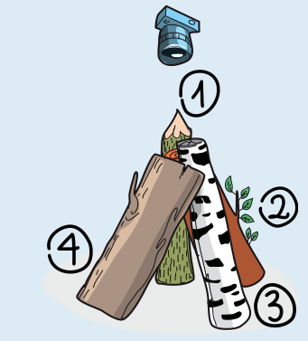
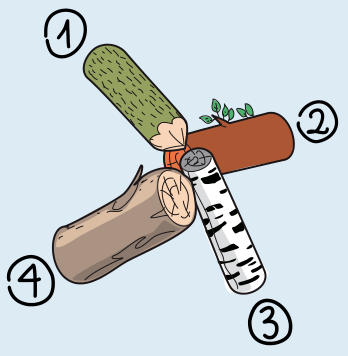
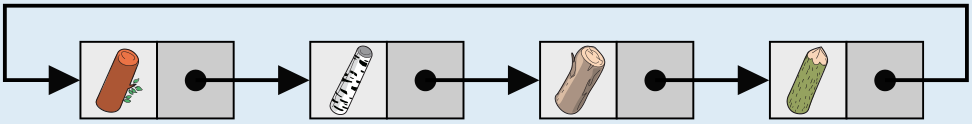

**Antwort D** ist richtig.

Die Baumstämme, die der Biber fotografiert hat, sind im Kreis angeordnet. Um herauszufinden, welches Foto das richtige ist, betrachten wir die Reihenfolge der Baumstämme in dieser Anordnung. Wir wählen einen Baumstamm aus (z. B. den angespitzten Baumstamm) und geben ihm die Nummer 1. Dann bestimmen wir, welcher Baumstamm links daneben ist und geben ihm die Nummer 2. Das machen wir solange, bis alle Baumstämme eine Nummer haben. In der Situation, die der Biber fotografiert hat, haben die Stämme also diese Reihenfolge: 1 (angespitzter Stamm) – 2 (brauner Stamm mit Blättern) – 3 (Birkenstamm) – 4 (dicker brauner Stamm).

Nun betrachten wir die Reihenfolge der Stämme in den Fotos A bis D. Dabei beginnen wir wie oben mit dem angespitzten Baumstamm 1 und gehen immer nach links:

- Foto A: 1 – 3 – 2 – 4
- Foto B: 1 – 4 – 3 – 2
- Foto C: 1 – 3 – 4 – 2
- Foto D: 1 – 2 – 3 – 4

Nur Foto D zeigt die richtige Reihenfolge.

## Das ist Informatik!

In dieser Biberaufgabe wird die Reihenfolge der Baumstämme betrachtet. Was bei wenigen *Elementen* (hier vier Baumstämmen) durch einfaches „Hinsehen“ und Vergleichen der Nachbarpaare möglich ist, erfordert bei Problemen mit viel mehr Elementen ein automatisiertes Vorgehen. In einem Computerprogramm, das benachbarte Elemente verarbeiten soll, könnten die Elemente in einer geeigneten Datenstruktur wie einer verketteten Liste gespeichert werden:

In einer *verketteten Liste* wird jedes Datenelement in einem einzelnen Knoten gespeichert. Zusätzlich ist in jedem Knoten ein *Verweis* auf den nächsten Knoten in der Liste gespeichert. Enthält der letzte Knoten einen Verweis auf den ersten Knoten, so handelt es sich um eine ringförmige Datenstruktur. Das ist im Beispiel wichtig, damit man bei jedem beliebigen Baumstamm starten und die Liste durchlaufen kann.
