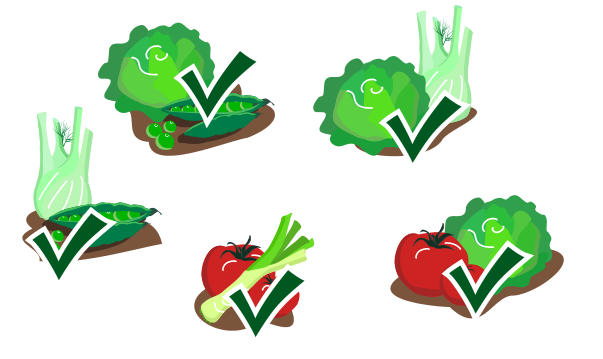
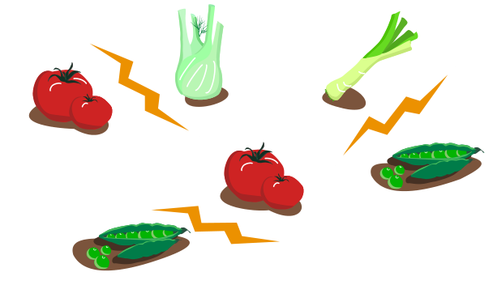

Lisa legt ein Gemüsebeet an, mit sechseckigen Bereichen. Darauf will sie Gemüse pflanzen, in jeden Bereich eines. Es gibt fünf Sorten Gemüse. Manche Gemüse vertragen sich gut miteinander (Haken), andere nicht (Blitz):

Beim Pflanzen beachtet Lisa folgende Regel: Gemüse, die sich nicht vertragen, dürfen nicht in Bereiche gepflanzt werden, die sich berühren.

In drei Bereiche hat Lisa schon Lauch gepflanzt. Du hast noch 3 Tomaten, 3 Salate, 2 Fenchel und 4 Erbsen.

**Bepflanze alle noch freien Bereiche und beachte Lisas Regel!**
