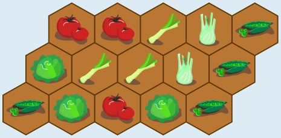
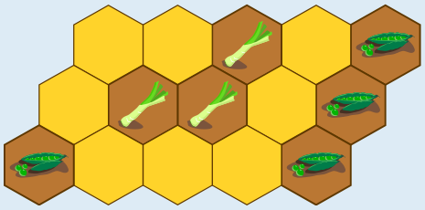
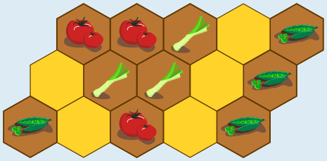
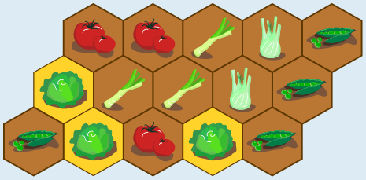
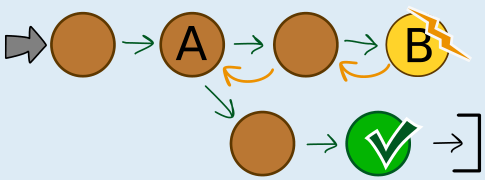

So ist es richtig:

Weil Erbsen sich mit Lauch nicht vertragen, pflanzt Lisa keine Erbsen in die gelben Bereiche. Für die Erbsen bleiben nur die übrigen Bereiche.

Weil Tomaten sich mit Erbsen nicht vertragen, pflanzt Lisa keine Tomaten in die gelben Bereiche. In die übrigen Bereiche kann sie Tomaten pflanzen; Tomaten vertragen sich mit Lauch.

Weil Tomaten sich mit Fenchel nicht vertragen, pflanzt Lisa keinen Fenchel in die gelben Bereiche. Den Fenchel kann sie in die beiden Bereiche zwischen Lauch und Erbsen pflanzen. In die gelben Bereiche kann sie Salat pflanzen: Für Salat ist Lisa keine Unverträglichkeit bekannt.

## Das ist Informatik!

Wer Gemüse so pflanzen will, dass die Ernte möglichst groß wird, muss viele Bedingungen beachten: Die einzelnen Sorten haben zum Beispiel unterschiedlichen Bedarf an Platz, Nährstoff und Licht. In dieser Biberaufgabe betrachten wir nur eine Art von Bedingung: die Verträglichkeit zwischen den Gemüsesorten.

Um eine Bepflanzung von Lisas Beet zu finden, die alle Verträglichkeitsbedingungen beachtet, könnte man so vorgehen: Man probiert systematisch alle Kombinationen aus, die Gemüse auf dem Beet zu platzieren. Erst wenn das Beet voll ist, wird geprüft, ob diese Kombination alle Bedingungen erfüllt und eine Lösung für Lisas Problem ist. In der Informatik ist solch ein Ausprobieren aller Kombinationen als *Brute-Force*-Methode bekannt. Bei Problemen mit vielen Kombinationen und nur wenigen Lösungen kann ein Vorgehen nach dieser Methode sehr lange dauern. Deshalb ist es meist besser, schrittweise vorzugehen und bei jedem Schritt alle Bedingungen zu berücksichtigen. Auf diese Weise haben wir die Lösung für Lisas Problem gefunden, und eine „falsche“ Kombination bzw. Bepflanzung des Beets konnte gar nicht entstehen.

Zum Glück ließ sich die Lösung auf direktem Weg finden: Es gab immer Bereiche, in die wir einige der noch übrigen Gemüse pflanzen konnten. Das gelingt im Allgemeinen nicht immer. Wenn man versucht, die Lösung schrittweise zusammenzusetzen, kann es bei einem Schritt A mehrere Möglichkeiten geben, alle Bedingungen zu erfüllen. Je nach Wahl kann es bei einem späteren Schritt B keine Möglichkeit mehr geben. Dann nimmt man die letzten Schritte solange zurück, bis man beim Schritt A mit den mehreren Möglichkeiten wieder angekommen ist. Dort wählt man eine andere Möglichkeit und versucht damit eine Lösung zu finden. In der Informatik ist diese Rücknahme von Schritten als *Backtracking* bekannt.

