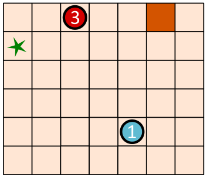
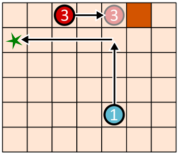
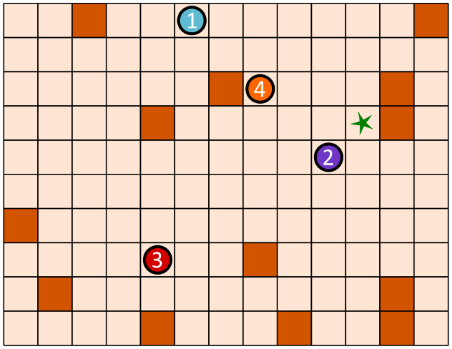

Die Go-Bots sind sehr einfache Roboter. Sie fahren über ein Spielbrett mit Feldern.

Um sie zu steuern, wählt man zunächst einen der Go-Bots aus. Den schickt man dann mit einem Pfeil-Befehl in eine Richtung: hoch, runter, links oder rechts.

Der Go-Bot fährt dann stur geradeaus, bis er direkt vor einem Hindernis (orangefarbenes Feld) oder einem anderen Roboter ankommt. Dort bleibt er stehen, bis er einen neuen Befehl bekommt.

Mit einer geschickten Folge von Befehlen sollst du dafür sorgen, dass Go-Bot 1 das Ziel (grüner Stern) erreicht, also genau dort stehen bleibt.

Unten links ist ein Spielbrett mit zwei Go-Bots. Mit dieser Befehlsfolge erreicht Go-Bot 1 das Ziel – siehe unten rechts. Die Befehlsfolge lautet: Go-Bot 3 rechts, Go-Bot 1 hoch, Go-Bot 1 links.

 

Unten ist ein anderes Spielbrett mit vier Go-Bots.

**Erstelle eine Befehlsfolge mit vier Pfeilen, mit der Go-Bot 1 das Ziel erreicht!**

Wähle immer abwechselnd einen Go-Bot und einen Pfeil aus, um die Befehlsfolge zu erstellen.
