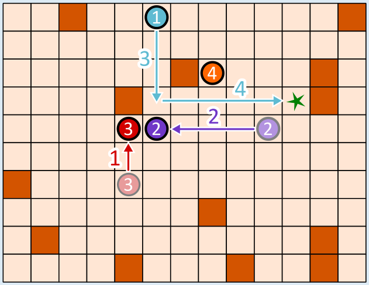

Die Befehlsfolge lautet: Go-Bot 3 hoch, Go-Bot 2 links, Go-Bot 1 runter, Go-Bot 1 rechts.

Damit Go-Bot 1 durch eine Befehlsfolge mit vier Pfeilen das Ziel erreichen kann, müssen drei Go-Bots kooperieren. Zuerst geht Go-Bot 3 nach oben, bis er vor einem Hindernis stehen bleibt. Damit wird er selbst zum Hindernis für Go-Bot 2 auf seinem Weg nach links. Wenn man nun Go-Bot 1 nach unten schickt, geht er bis Go-Bot 2 und kann von dort aus nach rechts gehen, wo er vor dem Hindernis stehen bleibt – auf dem Ziel.

Wie findet man die richtige Befehlsfolge? Man kann hinten anfangen und sich überlegen, was die letzte Bewegung von Go-Bot 1 zum Ziel sein muss. Es gibt nur zwei Möglichkeiten:

(a) Er kommt von links, wie in unserer Lösung.

(b) Er kommt von oben. In diesem Fall müsste Go-Bot 4 mit drei Befehlen nach oben rechts bewegt werden, um für Go-Bot 1 als Hindernis zu dienen. Wir benötigten dann 3 + 2 = 5 Pfeil-Befehle. Gesucht ist aber eine Folge mit vier Befehlen. Also muss Möglichkeit a) korrekt sein und Go-Bot 1 kommt von links zum Ziel. Dann geht die vorletzte Bewegung des Go-Bots 1 von oben nach unten. Damit er an der richtigen Stelle stehen bleibt, müssen zuvor Go-Bot 2 und Go-Bot 3 wie im Bild bewegt werden.

## Das ist Informatik!

In dieser Biberaufgabe haben mehrere Roboter zusammen gearbeitet, um gemeinsam ein Ziel zu erreichen. Dabei hatten sie unterschiedliche Aufgaben. Der blaue Roboter musste zum Ziel kommen, und die anderen dienten als Hindernisse.

Aufgabenverteilung ist ein wichtiger Aspekt der Robotik. Zum Beispiel arbeiten in einem automatisierten Warenlager unterschiedliche Roboter zusammen, um Waren einzulagern, wiederzufinden und zu transportieren. Dabei werden alle Aktivitäten so koordiniert, dass möglichst wenig nutzlose Ruhezeiten entstehen, alle Transportwege möglichst kurz sind, wenig Energie verbraucht wird und so insgesamt das Warenlager möglichst effizient arbeitet.

Ein besonderes Gebiet der Robotik sind Schwarmroboter. Das sind – wie die Go-Bots – einfache Maschinen, die in einer großen Gruppe gemeinsam eine Aufgabe lösen. In der Landwirtschaft können inzwischen Schwärme von Robotern die Aussaat von Mais erledigen, die Entwicklung der Pflanzen und die Bodenbeschaffenheit beobachten und schließlich sogar das Getreide ernten. Jeder Schwarmroboter ist klein und einfach konstruiert, aber der Schwarm als Ganzes kann Großes leisten. Dieses Prinzip gilt auch für Multiagentensysteme: Das sind einfache Softwareeinheiten, die gemeinsam komplexe Probleme lösen können. Die Aufgabe der Informatik ist, Algorithmen für eine optimale Koordination und Kooperation von Gesamtsystemen mit mehreren Akteuren – ob Hardware oder Software – zu entwickeln.
