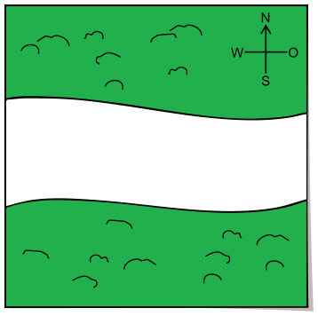
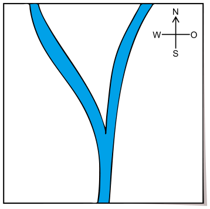

Karla hat drei Karten, die alle genau das gleiche Gebiet zeigen. Eine Karte zeigt die Wälder, eine die Flüsse und eine die Häuser in diesem Gebiet. Karlas Traumhaus liegt im Wald und in der Nähe eines Flusses.

 

**Welches ist Karlas Traumhaus? Klicke es auf der Karte der Häuser an.**
