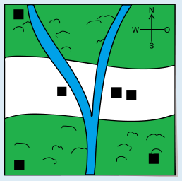

Das Haus oben links auf der Hauskarte ist Karlas Traumhaus.

Um Karlas Traumhaus zu finden, müssen die Informationen aus allen drei Karten ausgewertet werden. Das Traumhaus muss sich in einem Waldgebiet und in der Nähe eines Flusses befinden. Das trifft nur auf das Haus oben links zu. Dies ist leicht zu erkennen, wenn die Karten übereinander gelegt werden:

## Das ist Informatik!

Wenn die Informationen über die Wälder, die Flüsse und die Häuser auf einer einzigen Karte dargestellt sind, ist es einfach, das gesuchte Haus zu finden.

Ein *Geoinformationssystem* (GIS) führt eine Vielzahl räumlicher Informationen (z. B. Wälder, Straßen, Landesgrenzen, Tankstellen, Rathäuser, Überschwemmungsgebiete usw.) zusammen und stellt diese auf einer Karte dar. Ein GIS dient also der Visualisierung und Analyse sogenannter *Geodaten*. Mit Hilfe eines GIS ist es z. B. für Katastrophenschutzbeauftragte möglich, Informationen für Evakuierungspläne zusammenzustellen.

Die Verwendung mehrerer Ebenen mit unterschiedlichen Bildinformationen ist auch aus Grafikprogrammen bekannt. Eine wichtige Frage ist immer, welche Ebene mit den darin enthaltenen Objekten die oberste ist und deshalb im Vordergrund dargestellt wird. Im Beispiel sollte die Hauskarte die oberste Ebene sein, damit die Häuser nicht von den Waldflächen verdeckt werden.
