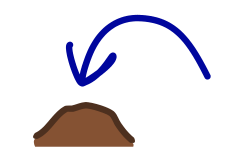
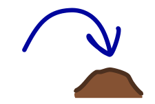
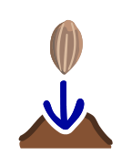
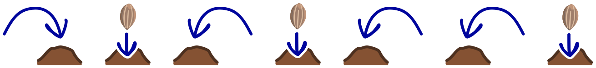

Der Kaninchenroboter kann folgende Anweisungen ausführen:

| Anweisung | Bedeutung |
|---|---|
|  | Springe nach **links** auf den nächsten Hügel. |
|  | Springe nach **rechts** auf den nächsten Hügel. |
|  | **Pflanze** einen Karottensamen auf dem Hügel, auf dem du stehst. |

Der Kaninchenroboter hat diese Folge von Anweisungen ausgeführt:

Dabei ist der Roboter auf vier Hügeln gewesen. Wir wissen aber nicht, auf welchem Hügel er angefangen hat.

**Auf welche Hügel hat der Roboter die Karottensamen gepflanzt? Tippe die Hügel A bis D (von links nach rechts) an, auf denen ein Samen liegt.**
