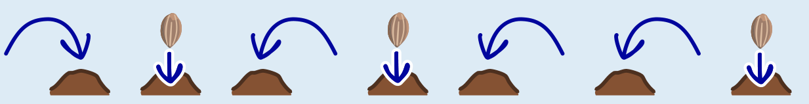
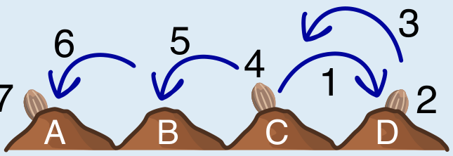

---
answers:
  - { A: s1, C: s2, D: s3 }
  - { A: s1, C: s3, D: s2 }
  - { A: s2, C: s1, D: s3 }
  - { A: s2, C: s3, D: s1 }
  - { A: s3, C: s1, D: s2 }
  - { A: s3, C: s2, D: s1 }
---
Die Karottensamen liegen auf den Hügeln A, C und D.

Um die richtige Antwort besser erklären zu können, geben wir den Hügeln Buchstaben (siehe oben) und den Anweisungen Nummern:

Zuerst bestimmen wir den Startpunkt des Roboters: Da der Roboter dreimal hintereinander nach links springt (Anweisungen 3, 5, 6), muss er vorher auf Hügel D stehen. Bevor er dreimal nach links springt, springt er einmal nach rechts (Anweisung 1). Der Roboter hat also auf Hügel C angefangen. Folglich werden die Karottensamen – den Anweisungen 2, 4 und 7 entsprechend – zuerst auf Hügel D, dann auf Hügel C und zuletzt auf Hügel A gepflanzt.

## Das ist Informatik!

Echte Roboter haben eingebaute Computer, und die werden so ähnlich programmiert wie der Kaninchenroboter. Ein Computerprogramm besteht aus vielen einzelnen *Anweisungen*.

In unserem Fall wird die Abfolge der Anweisungen für den Roboter-Computer mit Hilfe von Bildblöcken angegeben. Das Ergebnis (*Output*) des Programms hängt nicht nur von der Startposition (*Input*), sondern auch von der Folge und Reihenfolge der Anweisungen ab.

Diese Biberaufgabe zeigt ein Beispiel für den Einsatz von Robotern in der Landwirtschaft. Roboter können nicht nur pflanzen, sondern auch bewässern, bestäuben oder Pflanzenschutzmittel gezielt verteilen.
