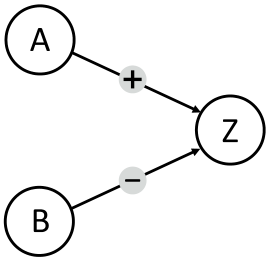
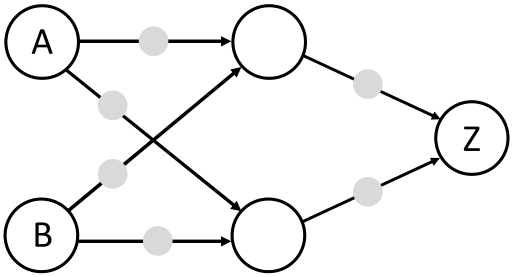

Anna und Ben wollen einen „Konflikt-Detektor“ bauen, der anzeigt, ob sie unterschiedlicher Meinung sind.

Sie verwenden Einheiten, die in zwei Zuständen sein können: Ja und Nein. Zwei Einheiten können mit einem Kabel verbunden werden. Wenn eine Einheit im Zustand Ja ist, sendet sie über alle ausgehenden Kabel ein Signal; ist sie im Zustand Nein, sendet sie kein Signal. Die Kabel werden so eingestellt, dass sie ein Signal als positives (+) oder negatives (–) Signal an die rechts angeschlossene Einheit übermitteln. Eine angeschlossene Einheit geht in den Zustand Ja, wenn sie mehr positive als negative Signale empfängt, und sonst in den Zustand Nein. Als Eingabe setzt Anna den Zustand der Einheit A und Ben den Zustand der Einheit B.

Zuerst bauen Anna und Ben diese Maschine:

Sie bemerken, dass die Einheit Z nur dann Ja ist, wenn A Ja und B Nein ist. Das ist nicht das, was sie wollen.

Dann bauen Anna und Ben eine größere Maschine (unten im Bild) und sind sicher, dass sie der Konflikt-Detektor sein kann: Z soll nur dann Ja sein, wenn A und B in unterschiedlichen Zuständen sind (Ja und Nein bzw. Nein und Ja). Ansonsten soll Z im Zustand Nein sein. Jetzt müssen nur noch die Kabel richtig eingestellt werden.

**Stelle für jedes Kabel ein, ob es ein Signal positiv (+) oder negativ (–) übermittelt, damit der Konflikt-Detektor korrekt arbeitet.**
