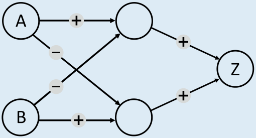
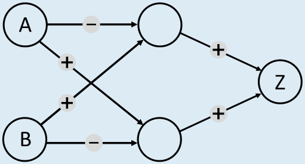
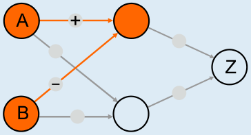
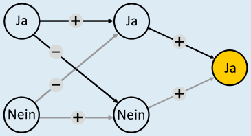
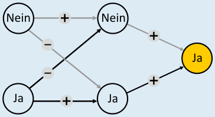
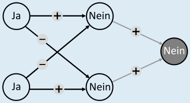
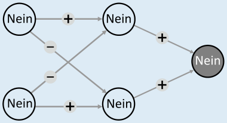

---
answers:
  - { a1: plus, a2: minus, b1: minus, b2: plus, z1: plus, z2: plus }
  - { a1: minus, a2: plus, b1: plus, b2: minus, z1: plus, z2: plus }
---
Mit diesen beiden Einstellungen arbeitet der Konflikt-Detektor korrekt.

 

Im Konflikt-Detektor muss die Ausgabe-Einheit genau bei zwei unterschiedlichen Eingaben (A = Ja und B = Nein sowie A = Nein und B = Ja) auf Ja sein. Z kann nur Ja sein, wenn über die zwei eingehenden Kabel mehr positive als negative Signale ankommen. Mindestens eines der Kabel muss also ein positives Signal (+) übermitteln. Nehmen wir einmal an, nur das obere Kabel, das zu Z führt, wird auf + gestellt. Dann muss die Einheit oben Mitte beide gewünschten Eingabekombinationen erkennen können, also in beiden Fällen Ja sein. Zusammen mit den Eingabeeinheiten A und B bildet diese Einheit aber genau so eine Maschine, wie Anna und Ben sie zu Beginn gebaut haben. Sie kann nur in genau einem der gewünschten Fälle Ja sein, und zwar, wenn eines ihrer Kabel auf + und das andere auf – gestellt wird:

Es wird also für jeden der gewünschten Eingabefälle eine eigene Einheit in der Mitte benötigt, eine für A = Ja und B = Nein, die andere für A = Nein und B = Ja. Die Kabel zur ersten Einheit müssen auf + (Kabel von A) und – (B) gestellt werden, die Kabel zur anderen Einheit auf – (A) und + (B). Welche Einheit in der Mitte welchen Fall übernimmt, ist egal; deshalb gibt es bei den Kabeln von A und B zur Mitte zwei Möglichkeiten. Wenn nun jede Einheit in der Mitte in genau einem gewünschten Fall Ja ist, müssen beide Kabel von der Mitte zu Z auf + gestellt werden; nur dann ist Z = Ja in genau beiden gewünschten Fällen.

Für die erste richtige Antwort zeigen die Bilder unten die Funktion des Konflikt-Detektors. Man sieht: Die obere Einheit in der Mitte erkennt den Fall A = Ja und B = Nein, die untere den Fall A = Nein und B = Ja. Die jeweilige Einheit sendet ein positives Signal zu Z, und Z ist Ja. Für die anderen Eingaben (A = Ja und B = Ja sowie A = Nein und B = Nein) sind beide mittleren Einheiten Nein, Z empfängt kein positives Signal und ist damit auch Nein.

   

## Das ist Informatik!

Der Konflikt-Detektor verarbeitet zwei Eingabewerte (Ja oder Nein) und liefert die Ausgabe Ja genau dann, wenn die beiden Eingabewerte unterschiedlich sind. Diese logische Funktion nennt man Exklusiv-Oder (XOR, Kontravalenz). Die erste in dieser Biberaufgabe beschriebene Maschine von Anna und Ben (zwei Schalter und eine Ausgabe-Einheit) ist eine vereinfachte Version eines *Perzeptrons*, das Frank Rosenblatt im Jahr 1957 beschrieben hat. Die Ausgabe-Einheit bildet eine Nervenzelle (Neuron) nach, die Eingabesignale verarbeiten kann und ein Ausgabesignal erzeugt. Mit einem Perzeptron kann man zwar die logischen Operationen Und und Oder implementieren, nicht aber das Exklusiv-Oder. Dazu benötigt man eine weitere Schicht von Schalteinheiten wie in der Lösung dieser Aufgabe. Erst in den 1980er Jahren hat man das erkannt (z. B. Rumelhart, Hinton & Williams 1986) und war dann (später) in der Lage, künstliche neuronale Netze zu programmieren, die ähnlich wie das menschliche Gehirn arbeiten und z. B. Kamerabilder auswerten und Objekte erkennen können. Die Informatik hat Methoden entwickelt, wie große neuronale Netze mit vielen Schichten und Einheiten ihre Berechnungen effizient durchführen können. Solche Netze bilden die Grundlage vieler aktueller KI-Systeme.
