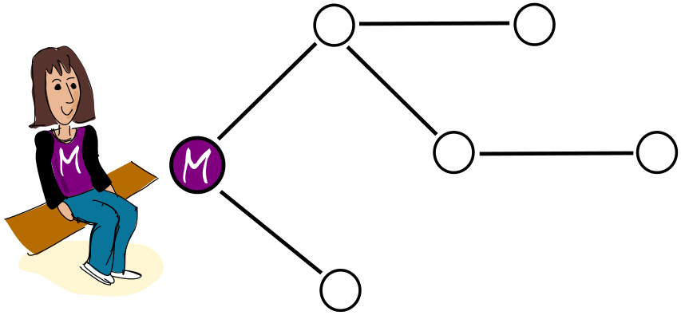

In Martinas Dorf gibt es sechs Häuser. Außerdem gibt es Wege, über die man von einem Haus zum nächsten gehen kann. Für alle diese Wege benötigt Martina die gleiche Zeit.

Martina hat eine besondere Karte des Dorfs gezeichnet. Sie hat darin Wege eingezeichnet, über die sie am schnellsten zu den anderen Häusern gehen kann.

Natürlich gibt es auch eine richtige Karte des Dorfs, mit allen Wegen.

**Welche dieser Zeichnungen kann nicht die richtige Karte sein?**
