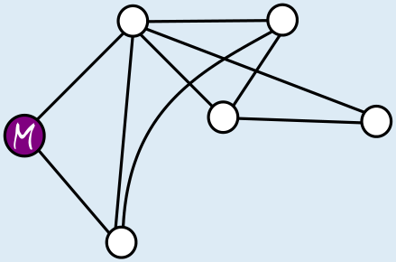

**Antwort C** ist richtig.

Martinas besondere Karte zeigt, dass sie zu dem Haus ganz rechts am schnellsten über drei Wege gehen kann. Wenn C die richtige Karte des Dorfes wäre, dann könnte Martina schneller zu diesem Haus gehen, nämlich über zwei Wege. Also kann C nicht die richtige Karte des Dorfes sein.

Bei den Karten A, B und D gibt es keine Möglichkeit, schneller zu einem der anderen Häuser zu gehen als über die Wege auf Martinas besonderer Karte. Diese Karten könnten also richtige Karten des Dorfes sein.

## Das ist Informatik!

Martina ist Informatikerin. Sie hat ihre Karte als Graph gezeichnet. Graphen bestehen aus Knoten (hier die Häuser), die durch Kanten (hier die Wege) verbunden sein können. Sie sind in vielen Bereichen der Informatik geeignet, die Realität zu modellieren – auch hier in dieser Biberaufgabe.

Martina weiß, dass es für Graphen eine ganze Reihe von Algorithmen gibt, beispielsweise die sogenannte Breitensuche, um Aufgaben zu lösen wie „Wie kommt man am schnellsten zu einem anderen Haus?“. Vielleicht hat sie ihre besondere Dorfkarte mit Hilfe einer Breitensuche in einem größeren Graph, der richtigen Karte des Dorfes mit allen Wegen, erstellt.

In der Graphentheorie, die sich mit Graphen und Graph-Algorithmen beschäftigt, entspricht Martinas Karte einem Teilgraph der Gesamtkarte des Dorfes. Martinas Teilgraph hat zwei Besonderheiten:

- Alle Knoten sind direkt (über eine Kante) oder indirekt (über mehreren Kanten) miteinander verbunden.
- Egal welche zwei Knoten man zufällig auswählt, es gibt immer nur genau einen Weg zwischen den beiden.

Ein Graph mit diesen Besonderheiten wird in der Informatik als Baum bezeichnet. Martinas Haus stellt die Wurzel des Baumes dar. Von der Wurzel aus kann Martina alle anderen Knoten (die anderen Häuser im Dorf) auf einem eindeutigen Weg erreichen. Martinas Teilgraph ist also ein Baum; außerdem enthält er alle Knoten des gesamten Graphen (der Gesamtkarte des Dorfes) – aber möglicherweise nicht alle Kanten. Ein Teilgraph mit diesen Eigenschaften wird als Spannbaum des gesamten Graphen bezeichnet.

In der Informatik gibt es viele Anwendungen für Graph-Algorithmen, vor allem im Zusammenhang mit Netzwerken (Verkehrsnetze, Telekommunikationsnetze …), etwa bei der Berechnung von Routen in Navigationssystemen. Spannbäume können beim Aufbau kostengünstiger Netze eingesetzt werden und hilfreich bei der Lösung besonders schwieriger Probleme sein.
