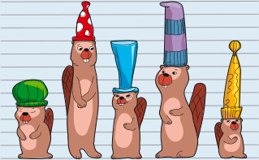
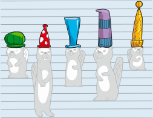

So sind die Hüte richtig sortiert; sie werden von links nach rechts immer höher:

Beim Umordnen der Biber achten wir nur auf die Hüte. Dann ist es viel einfacher, sie der Höhe nach zu sortieren.

 

## Das ist Informatik!

Aus einer großen Menge von Dingen können wir bestimmte Dinge besser heraussuchen, wenn die Menge sortiert ist: Wenn Werkzeuge nach Größe sortiert sind, lässt sich das passende Werkzeug leichter finden. Weil die Einträge in einem Wörterbuch alphabetisch sortiert sind, kann man die Seite mit dem gesuchten Wort schneller finden. In dieser Biberaufgabe sollst du die Biber sortieren, und zwar nach der Höhe ihrer Hüte. Die Schwierigkeit dabei ist, dass die Eigenschaft „Höhe der Hüte“ nicht leicht erkennbar ist. Deshalb muss man sehr genau hinsehen.

Beim Sortieren ist es also erstens wichtig, die Eigenschaft klar festzulegen, nach der sortiert werden soll. Zweitens müssen die Werte dieser Eigenschaft sortierbar sein. Nach Eigenschaften, die in Zahlen ausgedrückt werden (wie z. B. Höhe, Länge, Gewicht, ...) kann man sortieren: Für zwei verschiedene Zahlen können wir sagen, welche Zahl die kleinere ist. Wörter kann man sortieren, weil die Reihenfolge der Buchstaben im Alphabet festgelegt ist und deshalb für zwei verschiedene Wörter klar ist, welches weiter vorne im Wörterbuch stehen muss. Allgemein kann man sagen: Eine Eigenschaft ist sortierbar, wenn man für ihre einzelnen Werte eine eindeutige „kleiner als“-Beziehung (eine *Ordnung*) angeben kann.

Mit Computern werden große Datenmengen verwaltet. Um darin einzelne Daten schnell finden zu können, müssen die Datenmengen sortiert sein. Die Informatik kennt viele schnelle Sortierverfahren, und es ist gut untersucht, in welchen Fällen welche Verfahren angewendet werden sollen.
