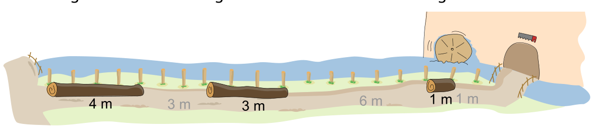

Biber Noah schneidet Holzstämme in verschiedenen Längen zu und verkauft sie dann. Sobald er einen Stamm zugeschnitten hat, legt er ihn auf dem 18 Meter langen Weg ab. Dabei beachtet Noah folgende Regel: Er legt den Stamm in die erste Lücke von links, in die der Stamm passt.

Noah verkauft einige Stämme. Danach gibt es drei Lücken auf dem Weg:

Nun will Noah vier Stämme zuschneiden, mit Längen von 1, 2, 3 und 4 Metern.

**In welcher Reihenfolge muss Noah die Stämme zuschneiden, damit er alle vier in die Lücken legen kann?**
