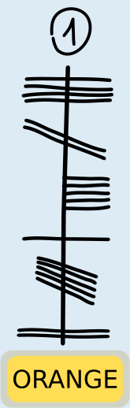
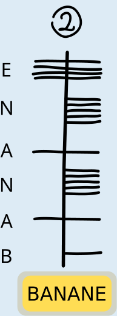
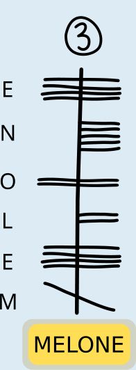
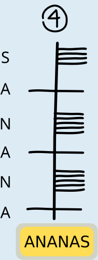

Code 1 ist ORANGE, Code 2 ist BANANE, Code 3 ist MELONE und Code 4 ist ANANAS. In Ogham schreibt man von unten nach oben.

   

Es gibt verschiedene Möglichkeiten, die richtige Zuordnung zu bestimmen. Auf jeden Fall aber muss herausgefunden werden, in welcher Richtung die Buchstaben entlang der Linie geschrieben werden. Dabei hilft das besonders markante Wort ANANAS. Darin kommt der Buchstabe A dreimal vor, mit jeweils einem anderen Buchstaben dazwischen.

Nur im Ogham-Code 4 kommt ein Buchstabe dreimal vor, und auch dort ist jeweils ein Buchstabe dazwischen. Code 4 ist also der einzige, zu dem das Wort ANANAS passt. So erkennt man, dass man in Ogham Wörter von unten nach oben schreibt und dass der dreifach vorkommende Buchstabe A in Ogham als horizontaler Strich durch die Linie geschrieben wird.

Dieser Ogham-Buchstabe A kommt nur im Code 2 zweimal vor. Auch wegen der aus ANANAS bekannten Kodierung von N (fünf horizontale Striche rechts von der Linie) und der Anordnung der weiteren Buchstaben passt nur BANANE zu diesem Code. ORANGE passt nur zum Code 1; unter anderem, weil man dort den Ogham-Buchstaben A genau einmal findet. Nun ist nur noch Code 3 übrig; er muss also das Ogham-Wort für MELONE sein und enthält die von den übrigen Wörtern bekannten Ogham-Buchstaben E und N an den passenden Stellen.

## Das ist Informatik!

In dieser Biberaufgabe muss ein unbekannter Text entschlüsselt bzw. dechiffriert werden. Das ist hier nicht sehr schwierig, weil der entschlüsselte Klartext bekannt ist. Außerdem ist der unbekannte Text auf gleiche Weise in Buchstaben und Wörter eingeteilt wie der bekannte Text.

Beim Dechiffrieren eines geheimen Textes bzw. eines Textes in unbekannter Schrift, dessen Klartext nicht bekannt ist, hilft es oft, sich Gedanken über die Häufigkeit von Buchstaben und Wörtern zu machen und auf dieser Grundlage zu versuchen, sie im Text zu finden. Auf diese Weise sind einige antike Alphabete und Schriften entschlüsselt worden.

Schwierig wird es aber, wenn die Schriftzeichen im unbekannten Text nicht so einfach den Buchstaben und Wörtern der bekannten Sprache zuzuordnen sind wie im Fall von Ogham. Dann hilft oft nur der Abgleich mit bekannten Texten oder Schriften, wie in dieser Biberaufgabe. Zum Beispiel wurden die ägyptischen Hieroglyphen jahrhundertelang nicht entschlüsselt, bis durch einen Zufall ein Stein mit Hieroglyphen und zwei bekannten Schriften gefunden wurde, der Stein von Rosetta. Auf dem Stein fand sich dreimal der gleiche Text. Der war zwar in verschiedenen Sprachen geschrieben, enthielt aber immer dieselben Namen. So konnten wesentliche Elemente der Hieroglyphen entschlüsselt werden.

Das gilt aber nicht für alle Schriften: Noch immer sind die etwa 650 Schriftzeichen der Maya-Kultur nicht vollständig entschlüsselt, genau so wenig wie die Schriften Linearschrift A und Linearschrift B aus der Mittelmeerregion.

Auch in der Informatik werden Schriftzeichen und Texte entschlüsselt – nachdem sie vorher zur abhörsicheren Datenübertragung verschlüsselt wurden. Dazu werden aber ganz andere Verfahren verwendet als bei der Kodierung von Wörtern in anderen Schriften. Solche einfachen Kodierungen sind insbesondere mit Hilfe von Computern zu leicht zu entschlüsseln, meist mit Hilfe der oben schon genannten Überlegungen zur Häufigkeit von Buchstaben und Wörtern.
