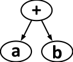
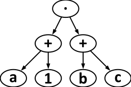

Ein mathematischer Ausdruck besteht aus

- einem Operator: +, –, · oder :
- und den Operanden: Zahlen wie 1, 2, …, Buchstaben wie a, b, … oder wieder Ausdrücke wie (1 + 2).

Die Struktur eines mathematischen Ausdrucks kann man als Strukturbaum darstellen. Dieses Diagramm aus Operatoren und Operanden wird so gezeichnet: Ein Kringel mit dem Operator wird durch Pfeile mit den Strukturbäumen der Operanden verbunden. Das sind im einfachsten Fall Kringel mit einer Zahl oder einem Buchstaben.

Aus einem Strukturbaum wiederum kann man die Postfix-Notation eines mathematischen Ausdrucks ablesen. In dieser Notation werden für jeden Ausdruck zunächst die Operanden und dahinter der Operator geschrieben.

Die Tabelle zeigt für zwei Ausdrücke ihre Strukturbäume und Postfix-Notationen:

| Mathematischer Ausdruck | a + b | (a + 1) · (b + c) |
|---|---|---|
| Strukturbaum |  |  |
| Postfix-Notation | a b + | a 1 + b c + · |

Hier ist die Postfix-Notation eines anderen Ausdrucks: a 1 + b 2 + · 25 c : +

**Welchen Strukturbaum hat dieser Ausdruck?**
