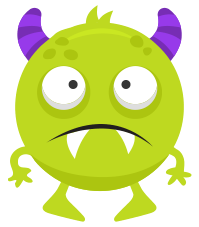
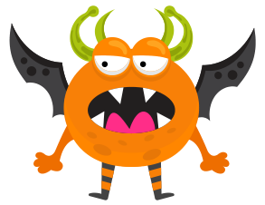
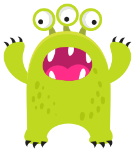
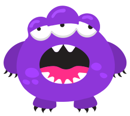
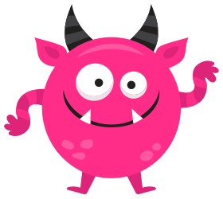

Evelyn hat fünf Bilder von Riccas. Sie beschreibt in Sätzen, wie Riccas aussehen.

    

Ihre Freundin Lydia zeigt ihr ein sechstes Bild von einem Ricca:

Nun stellt Evelyn fest: Einer ihrer Sätze über Riccas ist sicher falsch.

**Welcher dieser Sätze über Riccas ist nun sicher falsch?**
