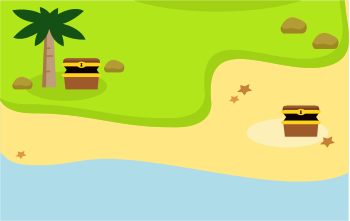
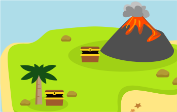

Auf einer Insel gibt es drei Schatzkisten: Eine Kiste ist am Fuß des Vulkans, die zweite ist unter einer Palme, und die dritte ist am Strand. Alle Kisten sind leer.

An einem Tag kreuzt der Pirat Biberbart auf, füllt eine der Kisten mit Gold und verschließt sie. Am gleichen Tag sind drei Touristinnen auf der Insel: Anita, Britta und Carla. Jede macht ein Foto: eine, bevor Biberbart Gold in eine Kiste gefüllt hat, die anderen beiden danach.

| Anitas Foto … | Brittas Foto … | Carlas Foto … |
|---|---|---|
| … zeigt die Kiste am Strand. | … zeigt die zwei Kisten unter der Palme und am Strand. | … zeigt die zwei Kisten unter der Palme und am Fuß des Vulkans. |
|  |  |  |

Auf den Fotos sind alle Kisten leer. Biberbart hatte also Glück, dass keine Touristin sein Gold gefunden hat.

**In welcher Schatzkiste ist das Gold?**

Klicke die Kiste auf der Insel an, in der das Gold ist.
