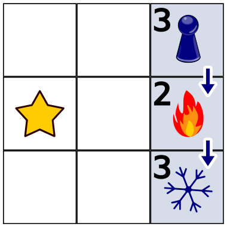

Nina und Daniel spielen Schatzsuche. Auf einem Spielbrett mit quadratischen Feldern wählt Nina im Kopf ein Feld aus. Dort ist der Schatz versteckt.

Daniel wählt ein Startfeld aus. Von dort geht er schrittweise mit seiner Spielfigur um je ein Feld weiter: nach links, rechts, oben oder unten.

Beim ersten Versuch nehmen sie ein kleines Spielbrett. Nina versteckt den Schatz auf dem Feld mit dem Stern. Daniel startet rechts oben und macht zwei Schritte entlang der Pfeile. Nach jedem Schritt sagt Nina, ob Daniel nun näher (Flamme) am Schatz oder weiter weg (Schneeflocke) vom Schatz ist als vor dem Schritt – siehe Bild. Die Zahlen zeigen Daniels Entfernungen vom Schatz: jeweils die kleinste Anzahl Schritte, mit denen Daniel aktuell zum Schatz gehen könnte.

Nun nehmen sie ein größeres Spielbrett. Nina versteckt den Schatz auf einem der blau markierten Felder. Das Bild zeigt Daniels Schritte und was Nina nach jedem Schritt sagt.

**Wo ist der Schatz versteckt? Klicke das Feld an.**

(Hinweis: Im Heft sind die Symbole in der Aufgabe vertauscht beschrieben. Nach dem Beispiel und der Lösung steht die Flamme für „näher“ und die Schneeflocke für „weiter weg“.)
