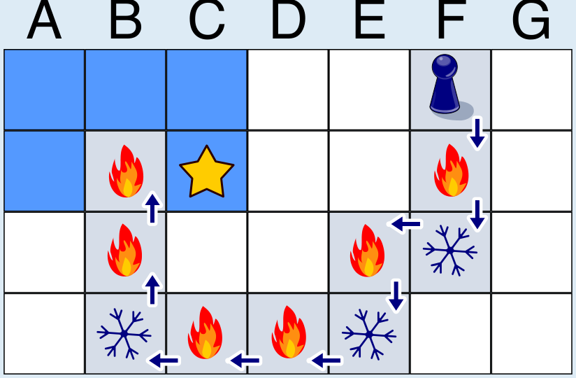

Der Schatz liegt auf dem Feld C2 (Spalte C, Zeile 2).

Wir verfolgen Daniels Weg und Ninas Rückmeldungen. Daniel startet in Zeile 1 des Spielbretts. Nach dem ersten Schritt ist er in Zeile 2 und näher am Schatz als in Zeile 1. Nach dem nächsten Schritt ist er in Zeile 3 und wieder weiter weg vom Schatz. Da er in der gleichen Spalte geblieben ist, muss der Schatz auf einem Feld in Zeile 2 sein. Denn egal, in welcher Spalte der Schatz versteckt ist: Den kürzesten Weg zum Schatz von einer anderen Spalte aus hat man, wenn man in der gleichen Zeile ist.

Aber in welcher Spalte ist der Schatz versteckt? Auf seinem weiteren Weg kommt Daniel in Zeile 4 mit einigen Schritten nach links dem Schatz zunächst näher; insbesondere ist er in Spalte C näher am Schatz als in Spalte D. Aber nach dem letzten Schritt in der Zeile ist Daniel in Spalte B weiter weg vom Schatz als in Spalte C. Der Schatz muss also auf einem Feld in Spalte C sein. Denn was wir oben für Spalten gesagt haben, gilt auch für Zeilen: Den kürzesten Weg zum Schatz von einer anderen Zeile aus hat man, wenn man in der gleichen Spalte ist.

## Das ist Informatik!

Daniel geht (mit seiner Spielfigur) über das Spielbrett. Von jedem Feld, auf dem er gerade steht, misst Nina die Entfernung zum Feld mit dem Schatz und nutzt dies für ihre Rückmeldung. Üblicherweise wird die Entfernung zwischen zwei Punkten als Länge der geradlinigen Verbindung zwischen den Punkten gemessen (*euklidische Distanz*). Doch die zwei Felder sind genau genommen keine Punkte. Deshalb bemisst Nina die Entfernung zwischen zwei Feldern in der Anzahl von Schritten, die Daniel für einen kürzesten Weg vom einen Feld zum anderen gehen müsste. Dieses Maß kann man generell bei Rastern anwenden und ist in der Informatik als *Manhattan-Distanz* bekannt – abgeleitet vom gerasterten Straßenplan des New Yorker Stadtteils Manhattan.

Informatikerinnen und Informatiker wählen die Art der Distanzberechnung zwischen zwei Objekten in Abhängigkeit von der Frage, die sie lösen möchten. Wenn man zum Beispiel die Entfernung zwischen zwei gleich langen Wörtern in einer natürlichen Sprache messen möchte, kann man die Anzahl Stellen, an welchen sich die Wörter unterscheiden, zählen; das ist dann der *Hamming-Abstand* oder die *Hamming-Distanz*. Sind die Wörter unterschiedlich lang, kann man die *Editierdistanz* verwenden. Entfernungen bzw. Distanzen spielen in der Informatik häufig eine Rolle, wenn es darum geht, optimale Lösungen eines Problems zu finden. Egal ob die Lösung eines Problems am schnellsten, am kürzesten oder am günstigsten sein soll: Man muss oft nicht den Algorithmus ändern, sondern nur das Entfernungsmaß: Dauer, Länge oder Kosten.
