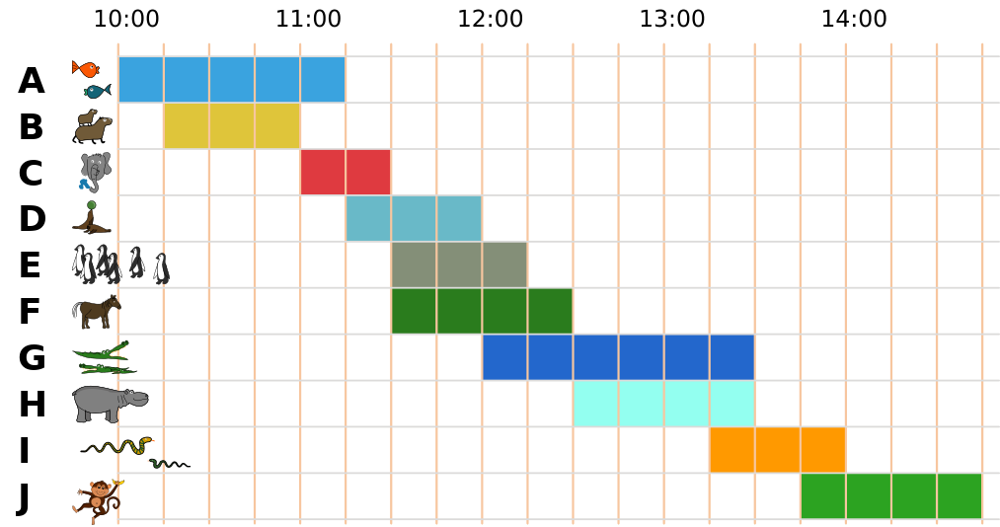

Heute ist Ali im Zoo. Er will möglichst viele verschiedene Vorführungen besuchen.

Hier ist ein Plan mit allen Vorführungen. Zum Beispiel siehst du ganz unten: Die Vorführung der Affen beginnt um 13:45 Uhr und endet um 14:45 Uhr.

Ali besucht eine Vorführung immer ganz, von Anfang bis Ende. Kannst du Ali helfen?

**Wähle so viele Vorführungen wie möglich aus, die Ali nacheinander besuchen kann.**

(Die Buchstaben A bis J wurden hier zur Orientierung ergänzt.)
