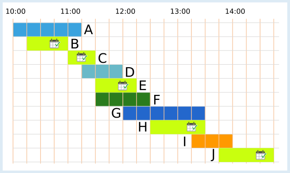
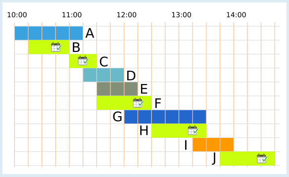

---
answers:
  - [b, c, e, h, j]
  - [b, c, f, h, j]
---
Ali kann höchstens 5 Vorführungen nacheinander besuchen. Das sind die beiden richtigen Antworten (B, C, E, H, J oder B, C, F, H, J):

 

Es gibt unterschiedliche Wege, die richtigen Antworten zu finden.

Ein Besuchsplan für Ali ist eine Auswahl von Vorführungen, die er nacheinander besuchen kann. Ein Weg zu den richtigen Antworten ist es, alle Besuchspläne aufzulisten. In dieser Liste sind die Pläne mit den meisten Vorführungen die richtigen Antworten. Alle Besuchspläne zu finden, ist leider sehr zeitaufwändig.

Aber könnte es nicht auch einen Besuchsplan mit 6 Vorführungen geben? Wir versuchen einmal, einen zu erstellen. Vorher schauen wir uns die Dauer der Vorführungen genauer an: Der gesamte Tag ist auf dem Plan in 19 Zeiteinheiten zu je einer Viertelstunde unterteilt. Die Vorführungen dauern 2, 3, 4, 5 oder 6 Zeiteinheiten.

| Zeiteinheiten | Vorführungen |
|---|---|
| 2 | C |
| 3 | B, D, E, I |
| 4 | F, H, J |
| 5 | A |
| 6 | G |

Um möglichst viele Vorführungen in einen Besuchsplan zu packen, wählen wir so kurze Vorführungen wie möglich. Die 6 kürzesten Vorführungen dauern zusammen 18 Zeiteinheiten (2 + 3 + 3 + 3 + 3 + 4). Zu diesen kurzen Vorführungen gehören auch die Vorführungen C, D und E. Da die Vorführungen C und E aber genau hintereinander liegen, kann Ali Vorführung D dazwischen nicht besuchen.

Wir müssen also die Vorführung D durch eine andere möglichst kurze ersetzen. Es sind nur noch Vorführungen mit mindestens 4 Zeiteinheiten übrig. Ohne die Vorführung D benötigen wir deshalb insgesamt mindestens 19 Zeiteinheiten für 6 Vorführungen: 2 + 3 + 3 + 3 + 4 + 4. Aber: Welche zwei Vorführungen mit 4 Zeiteinheiten wir auch wählen, eine davon überschneidet sich immer mit einer Vorführung mit 3 Zeiteinheiten. Wir müssten auch diese durch eine Vorführung mit mindestens 4 Zeiteinheiten ersetzen und würden dann mindestens 20 Zeiteinheiten für 6 Vorführungen benötigen. Es stehen aber nur 19 Zeiteinheiten zur Verfügung! Wir schlussfolgern, dass es keinen Besuchsplan geben kann, der mehr als 5 Vorführungen enthält.

## Das ist Informatik!

Diese Biberaufgabe enthält einen Zeitplan der Vorführungen im Zoo. Solche Zeitpläne herzustellen, ist nicht einfach und wird in der Informatik als Scheduling-Problem bezeichnet. Natürlich möchte der Zoo seinen Besuchern ermöglichen, möglichst viele Vorführungen zu sehen, aber es müssen auch andere Bedingungen beachtet werden. Beispielsweise können Vorführungen nur angeboten werden, wenn die Tierpfleger Zeit haben, die verfügbaren Arenas frei sind und die Vorführungen sich mit den Lebensrhythmen der Tiere vereinbaren lassen.

Es gibt viele ähnliche Probleme im Leben, auf die sich dieselben Überlegungen anwenden lassen. Ein Beispiel ist die Erstellung eines Stundenplanes in der Schule, oder die Zuteilung von Kinofilmen zu Kinosälen. Die Erstellung dieser Zeitpläne ist so aufwändig, dass man dies schon für relativ kleine Beispiele (die Stundenpläne deiner Schule) oft nicht mehr von Hand erarbeiten kann. Auch die Prozessoren deines Computers müssen viele Aufgaben übernehmen und diese nacheinander abarbeiten. Der Zeitplan, wann welcher Prozessor was tut, wird vom Betriebssystem blitzschnell und ohne dass man es merkt erstellt. Scheduling ist eines der großen Themen der Informatik, mit welchen sich die Forschung auch heute noch beschäftigt.
