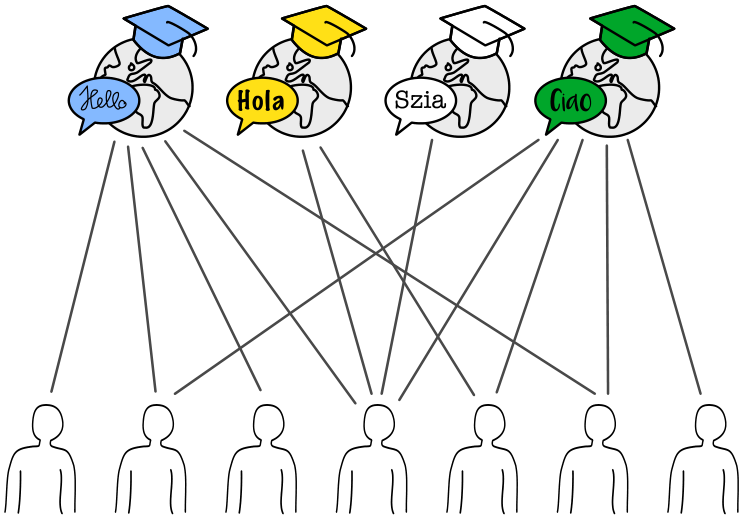

Eine Sprachschule plant vier Sommerkurse. Die Linien im Bild zeigen, welche Lehrperson der Schule (unten) für welchen Kurs (oben) geeignet ist.

Eine Lehrperson kann nur einen Kurs halten. Trotzdem gibt es mehrere Möglichkeiten, jedem Kurs eine geeignete Lehrperson zuzuordnen.

**Ordne jedem Kurs eine geeignete Lehrperson zu. Markiere dazu die Linie zwischen Person und Kurs.**
