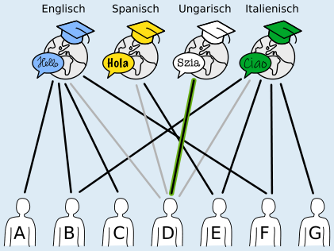
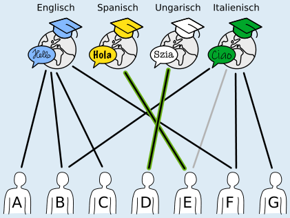
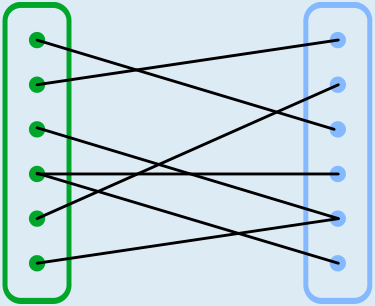

---
answers:
  - [eng-A, ita-B, ung-D, spa-E]
  - [eng-A, ita-F, ung-D, spa-E]
  - [eng-A, ita-G, ung-D, spa-E]
  - [eng-B, ita-F, ung-D, spa-E]
  - [eng-B, ita-G, ung-D, spa-E]
  - [eng-C, ita-B, ung-D, spa-E]
  - [eng-C, ita-F, ung-D, spa-E]
  - [eng-C, ita-G, ung-D, spa-E]
  - [eng-F, ita-B, ung-D, spa-E]
  - [eng-F, ita-G, ung-D, spa-E]
---
Es gibt 10 richtige Zuordnungen. Zum Ungarischkurs gehört immer Lehrperson D, zum Spanischkurs immer Lehrperson E.

Um die Antwort leichter erklären zu können, markieren wir die Lehrpersonen mit den Buchstaben A bis G. Die Sprachen, die in den Kursen unterrichtet werden, sind (von links nach rechts) Englisch, Spanisch, Ungarisch und Italienisch.

D ist die einzige Lehrperson, die für den Ungarischkurs geeignet ist. Sie muss diesem Kurs zugeordnet werden und kann keine weiteren Kurse übernehmen.

E ist jetzt die einzige Lehrperson, die für den Spanischkurs geeignet ist. Sie muss diesem Kurs zugeordnet werden und kann keine weiteren Kurse übernehmen.

Bei den beiden verbleibenden Kursen (Englisch und Italienisch) kann man recht frei wählen. B und F dürfen aber nur einem Kurs zugeordnet werden, auch wenn sie für beide geeignet sind.

Dadurch gibt es insgesamt 10 Möglichkeiten, jedem Kurs eine geeignete Lehrperson zuzuordnen:

| Englisch | Italienisch | Ungarisch | Spanisch |
|---|---|---|---|
| A | B | D | E |
| A | F | D | E |
| A | G | D | E |
| B | F | D | E |
| B | G | D | E |
| C | B | D | E |
| C | F | D | E |
| C | G | D | E |
| F | B | D | E |
| F | G | D | E |

## Das ist Informatik!

Ein Graph besteht aus Knoten (Punkten), die durch Kanten (Linien) verbunden sind. Eine spezielle Klasse von Graphen sind *bipartite Graphen*: Die Knoten lassen sich in zwei getrennte Teilmengen teilen, sodass es nur Kanten zwischen Knoten verschiedener Teilmengen gibt.

Die Situation in dieser Biberaufgabe kann durch einen bipartiten Graphen dargestellt werden: Eine Teilmenge besteht aus den Kursen und die andere aus den Lehrpersonen. Bipartite Graphen eignen sich sehr gut, Zuordnungsprobleme zu modellieren und zu lösen. Zuordnungsprobleme begegnen uns häufig im Alltag, z. B. bei Stundenplänen oder bei der Verteilung von Arbeit an Angestellte oder Maschinen. Bei kleineren Problemen ist es einfach möglich, eine optimale Zuordnung zu finden; bei größeren wird es jedoch relativ schnell sehr komplex. Aus diesem Grund wurden in der Informatik verschiedene Algorithmen entwickelt, um möglichst schnell möglichst viele passende Paare zu finden.

Zum Beispiel wird auch das sogenannte Heiratsproblem mithilfe eines bipartiten Graphen dargestellt. Dabei steht eine Menge von heiratswilligen Männern einer Menge von heiratswilligen Frauen gegenüber. Ziel des Verfahrens ist, unter Berücksichtigung der jeweiligen Wünsche, alle Männer beziehungsweise alle Frauen zu verheiraten. Der englische Mathematiker Philip Hall formulierte im Heiratssatz 1935 die Bedingungen, unter denen so eine Zuordnung möglich ist.

In unserer Variante geht es nicht um diese vollständige Zuordnung, sondern darum, möglichst jeden Knoten der einen Teilmenge (die Kurse) einem Knoten der anderen Teilmenge zuzuordnen.
