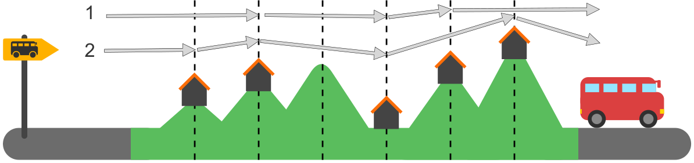

Mia mag Wanderurlaube, bei denen sie jede Nacht an einem anderen Ort übernachtet. Für ihren nächsten Urlaub hat Mia eine Karte der Region (siehe Bild). Die Karte zeigt Mias Startpunkt (links, gelbes Schild), ihr Ziel (rechts, roter Bus) und alle Orte, an denen sie übernachten kann (fünf Häuser).

Mia hat die Region mit gestrichelten Linien in Abschnitte eingeteilt. Sie kann immer nur einen oder zwei Abschnitte an einem Tag wandern. Zwei verschiedene Wanderungen, die sie machen kann, hat sie bereits in die Karte eingetragen. Wanderung 1 hat 3 Übernachtungsorte; Wanderung 2 hat 4 Übernachtungsorte.

**Wie viele verschiedene Wanderungen kann Mia insgesamt machen? Zähle die Wanderungen 1 und 2 mit.**
