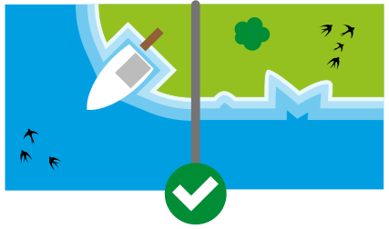
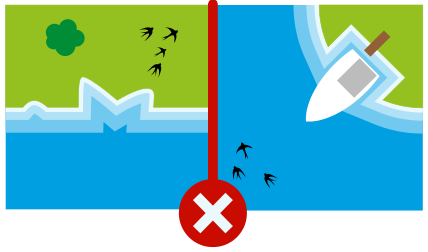

Edu hat ein neues Spiel. Das Spiel hat Kärtchen mit Wasser und Land. Edu legt die Kärtchen so aneinander, dass sie passen: Land an Land, Wasser an Wasser. Dann entstehen schöne Landschaften.

 

Edu legt zwei Kärtchen hin und lässt zwei Lücken.

**Welche Kärtchen passen in die Lücken?**

Ziehe dazu zwei der sechs Kärtchen in die Lücken. Die Kärtchen dürfen nicht gedreht werden.
