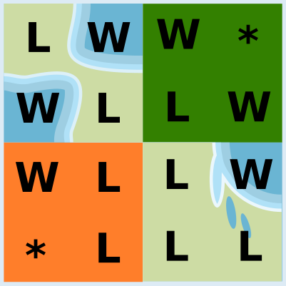
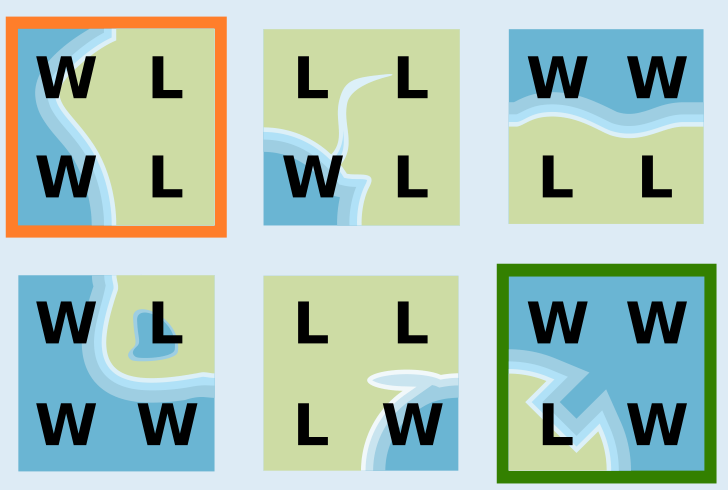

Das Kärtchen mit dem Boot (oben rechts) und das mit den fünf Vögeln (unten links) passen in die Lücken:

Überall liegt Wasser an Wasser und Land an Land. Von den sechs möglichen Kärtchen passen nur diese beiden Kärtchen in die Lücken.

Nur wenn man die Kärtchen drehen dürfte, würden noch weitere Kärtchen in die Lücken passen.

## Das ist Informatik!

Schauen wir uns Edus Kärtchen genauer an. Alle Kärtchen können in vier Bereiche geteilt werden. Dabei zeigen alle äußeren Ränder jedes Bereichs entweder Land oder Wasser.

Es gibt also nur zwei verschiedene Arten von Bereichen, Wasser (W) oder Land (L). Zwei Kärtchen passen aneinander, wenn benachbarte Bereiche die gleiche Art haben. Daher können wir für je drei Bereiche der beiden Lücken die erforderliche Art eintragen. Der vierte Bereich kann Wasser oder Land sein, deswegen tragen wir „*“ ein.

Auf diese Weise erstellen wir für jede Lücke ein Muster. Die Kärtchen, die die Lücken füllen sollen, müssen zu diesen Mustern passen: Wo ein Muster einen Buchstaben hat, muss das Kärtchen den gleichen Buchstaben haben; wo das Muster einen Stern hat, kann das Kärtchen irgendeinen Buchstaben haben. Zu jedem Muster passt nur ein Kärtchen auf der rechten Seite.

Wir haben eine Eigenschaft der Kärtchen entdeckt. Diese Entdeckung haben wir genutzt, um sie durch eine Anordnung der Zeichen L und W zu beschreiben. Durch diesen Schritt haben wir die in den Bildern enthaltenen Informationen erheblich reduziert. Wir konzentrieren uns auf die Informationen, die zur Lösung dieser Aufgabe erforderlich sind. Informatiker würden sich auf die Anordnung der Zeichen in den Bildern beziehen. Durch die Reduktion der Bilder auf die Bereichsarten L und W entsteht ein Modell für die fehlenden Kärtchen. *Modellierung* bedeutet *Abstraktion* (oder Vereinfachung), und Abstraktion reduziert die Information. Computer müssen mit Modellen von der Realität arbeiten. Bei der Erstellung solcher Modelle muss darauf geachtet werden, dass wichtige Eigenschaften der Realität nicht verloren gehen.
